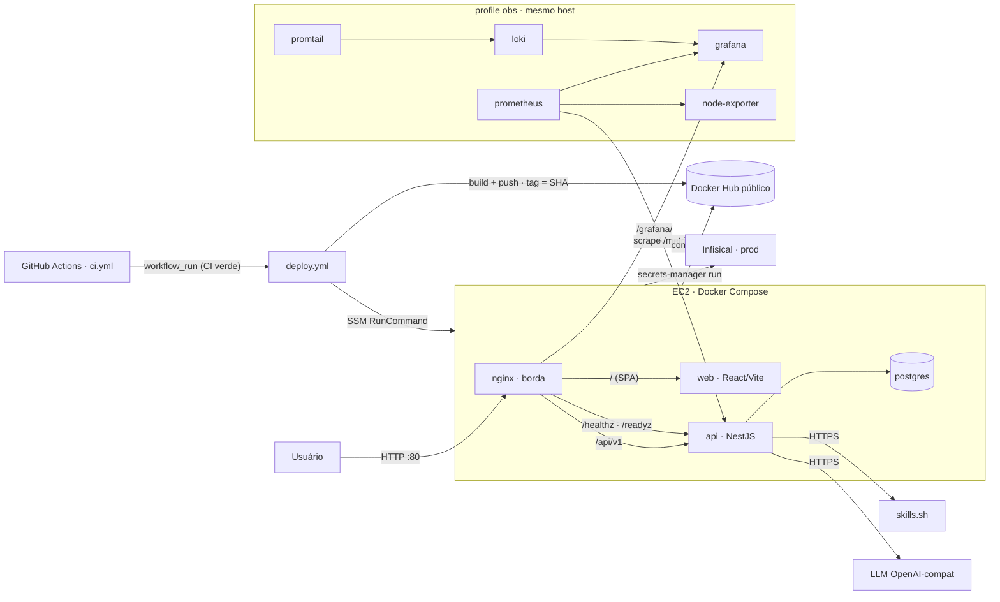

# Skill Finder — Projeto 2 (Computação em Nuvem · UFRPE)

O Skill Finder recebe, em linguagem natural, a descrição da skill de agente que a pessoa precisa e
devolve uma lista curta, **ordenada e explicada** de skills do catálogo do
[skills.sh](https://skills.sh). A LLM interpreta o pedido e redige o porquê; a ordem sai de uma
função pura do backend — a LLM **nunca** escolhe posição, **nunca** produz `score` e **nunca** cita
uma skill fora do conjunto já recuperado. O produto não instala a skill: decide qual instalar e
mostra a origem.

**Problema.** O skills.sh publica milhares de skills de agentes e não responde à pergunta que
importa — "qual delas resolve o *meu* caso?" —: a busca é por nome, não por intenção, e os sinais de
qualidade (estrelas, instalações, status de segurança, repositório de origem) estão espalhados pela
página de cada skill. Quem escolhe gasta tempo navegando e decide por impressão. O Skill Finder
transforma a necessidade em linguagem natural numa lista curta, ordenada por um score explicável e
acompanhada do porquê de cada posição.

Este repositório é o entregável do Projeto Integrador: aplicação + infraestrutura em Terraform +
pipeline CI/CD + observabilidade, na topologia da Opção 1 de
[`docs/01`](docs/01-analise-requisitos-e-arquitetura.md) (uma EC2 com Docker Compose). O
vocabulário do domínio está em [`CONTEXT.md`](CONTEXT.md).

## O que existe hoje

| Parte | O que está entregue |
| --- | --- |
| Aplicação | API NestJS 11 + TypeScript strict + Prisma/PostgreSQL 16; SPA React 18 + Vite; borda nginx; catálogo ingerido do skills.sh por rodízio |
| Infraestrutura | Terraform com state no S3: EC2 `t3.small`, security group, EBS de dados e attachment (4 recursos); imagens no Docker Hub público |
| Pipeline de CI | `.github/workflows/ci.yml` com **8 jobs**: `lint`, `typecheck`, `test-unit`, `test-integration`, `test-e2e`, `test-web`, `contract`, `secrets` (gitleaks) |
| Pipeline de deploy | `.github/workflows/deploy.yml` com **5 jobs** (`gate`, `build`, `provision`, `deploy`, `smoke`), disparado por `workflow_run` do CI verde; implantação por SSM, sem SSH |
| Observabilidade | Prometheus, Loki, Promtail, node-exporter e Grafana no profile `obs`; 4 painéis versionados; `/grafana/` na borda |
| Segurança | Os seis segredos vivem no Infisical (`prod`) e são lidos no host a cada deploy — nenhum `.env` no repositório, no host ou na imagem |
| Documentação | `docs/README.md` indexa edital, arquitetura, planos, runbook, segurança, observabilidade e evidências |

Último deploy verde verificado: run **`45273346584`** (2026-11-23), com `gate`, `build`, `deploy` e
`smoke` em `success` e `provision` `skipped` por desenho. A prova em arquivo está em
[`docs/evidencias/f4-gate.md`](docs/evidencias/f4-gate.md).

> **Estado do CI no HEAD atual:** o run `45282740836` reprovou no job `secrets` por um falso
> positivo do gitleaks em `docs/evidencias/f4-gate.md` (dois trechos de digest de imagem lidos como
> `generic-api-key`). O código não mudou; a correção do artefato está pendente. Um CI vermelho não
> gera deploy — o `workflow_run` só abre o `deploy.yml` com o CI verde.

## Arquitetura



O caminho de uma requisição: o navegador fala só com a borda (o `api` publica a porta apenas em
`127.0.0.1`); a SPA é estática; `/api/v1` e `/healthz`/`/readyz` são proxy para a API; `/grafana/`
pede login. O deploy não abre porta 22: o GitHub Actions publica as imagens no Docker Hub e envia o
comando ao host pelo **SSM RunCommand** do AWS Academy; o host lê os segredos no **Infisical** na
hora do deploy e sobe a stack com `docker compose`.

## Tecnologias e por quê

| Camada | Escolha | Por quê |
| --- | --- | --- |
| Backend | **NestJS 11** + TypeScript strict | um só idioma no monorepo, DI e validação prontas, Swagger gerado dos decorators (ADR-007) |
| Banco | **PostgreSQL 16 + Prisma** | busca lexical com `tsvector` + `pg_trgm` sem serviço extra; migrations versionadas (ADR-002) |
| Frontend | **React 18 + Vite** | SPA leve, build estático servido pelo nginx; tipos do contrato em `frontend/src/types.ts` |
| Borda | **nginx** | SPA + proxy `/api`, `/healthz`, `/readyz` e `/grafana/` numa única porta pública |
| Orquestração | **Docker Compose** | um host de 2 GB: profiles `dev`, `prod` e `obs` em um `compose.yaml` (ADR-005) |
| Infraestrutura | **Terraform** com state no S3 | ciclo `apply`/`destroy` reproduzível e sem órfãos; IAM pré-existente do lab vem por `data` |
| Registry | **Docker Hub público** | pull anônimo no host dispensa credencial na VM; tag = SHA do commit, sem `latest` |
| CI/CD | **GitHub Actions** | gate de testes explícito no grafo de jobs; deploy por `workflow_run`, não por push direto |
| Segredos | **Infisical Cloud** | fonte única, machine identity só de leitura; o runner não recebe segredo de aplicação |
| Observabilidade | **Prometheus + Loki + Promtail + Grafana + node-exporter** | RED, catálogo e logs correlacionados por `request_id`, com teto de memória por serviço (ADR-009) |
| Testes | **Jest + Supertest + nock** (backend), **Vitest** (frontend) | nenhum teste abre socket: `nock.disableNetConnect()` e catálogo de fixture |

## Estrutura do repositório

```
backend/           API NestJS 11 + Prisma: config, catalog, ranking, llm, search, contract, docs
frontend/          SPA React + Vite + TypeScript e nginx.conf da borda
infra/             Terraform: EC2, security group, EBS de dados, outputs do seam
observability/     Prometheus, Loki, Promtail, Grafana e os 4 painéis versionados
docs/              edital, análise, planos, spec, arquitetura, runbook, segurança, evidências
scripts/           bootstrap, verificação (verify.sh) e publicação do tracker
compose.yaml       postgres + api + web (profiles dev/prod) e a stack obs (profile obs)
Makefile           atalhos de desenvolvimento
```

## Como rodar localmente

Requisitos: Docker Desktop com **Compose ≥ 2.24** e, para desenvolvimento fora do Docker, **Node 22
+ pnpm** no WSL:

```bash
bash scripts/setup-node-wsl.sh    # Node 22 nativo + pnpm 12.21.0
make bootstrap                    # pnpm install nos dois pacotes
make config                       # valida o compose
make up                           # postgres + api + web (profile dev)
make logs
make down
```

A API responde em `http://localhost:8080` (`/healthz`, `/readyz`, `/metrics`, `/docs` com Scalar) e
a interface em `http://localhost:8081`. O roteiro verificado do zero está em
[`docs/app/04-rodar-local.md`](docs/app/04-rodar-local.md).

Para a stack de observabilidade local:

```bash
docker compose --profile dev --profile obs up -d
# Grafana em http://localhost:3000 (portas publicadas só em 127.0.0.1)
```

Em `PROFILE=prod` o backend recusa subir sem `DATABASE_URL`, `IP_HASH_SALT` e `LLM_API_KEY` (com a
LLM ligada), e recusa a senha de desenvolvimento do Postgres. Um `.env` em branco só serve para
`dev`.

## Como implantar

Pré-requisitos: sessão do AWS Academy ativa (três credenciais), `TF_STATE_BUCKET` exportado, os
secrets `AWS_ACCESS_KEY_ID`/`AWS_SECRET_ACCESS_KEY`/`AWS_SESSION_TOKEN`, `DOCKERHUB_TOKEN`,
`INFISICAL_CLIENT_ID`/`INFISICAL_CLIENT_SECRET` e a variable `DOCKERHUB_USERNAME` no GitHub. A
lista completa, sem valores, está em [`docs/app/06-pipeline-deploy.md`](docs/app/06-pipeline-deploy.md).

Com a infraestrutura no ar, o deploy de uma versão nova é um dispatch:

```bash
gh workflow run deploy.yml --ref main
```

`workflow_run` faz o mesmo automaticamente: todo CI verde em `main` abre o `deploy.yml`, que constrói
`api` e `web`, publica as duas imagens com a tag do SHA no Docker Hub, aplica as migrations por SSM
e roda o smoke na borda pública (qualquer desvio reprova o run).

Para subir infraestrutura e aplicação do zero, um dispatch só:

```bash
bash scripts/bootstrap-state.sh                         # uma vez por conta (bucket de state)
cp infra/terraform.tfvars.example infra/terraform.tfvars # project_name, state_bucket, dockerhub_user
gh workflow run deploy.yml --ref main -f provision=true
```

O procedimento manual equivalente (com `terraform plan` na tela e leitura do IP público) está em
[`docs/runbook-operacao.md`](docs/runbook-operacao.md) §1. O rollback é outro dispatch, com
`-f image_tag=<sha-anterior> -f skip_build=true` — as tags do Docker Hub não expiram.

## Como destruir

O `destroy` remove tudo o que o Terraform criou e para de gastar crédito; o bucket de state (criado
fora do state) sobrevive. Se quiser preservar o banco, faça o `pg_dump` antes — o procedimento está
no runbook §3.

```bash
terraform -chdir=infra init -reconfigure -backend-config="bucket=$TF_STATE_BUCKET"
terraform -chdir=infra plan -destroy
terraform -chdir=infra destroy
```

Depois do `destroy`, varra órfãos por tag (três tabelas vazias = nada ficou para trás):

```bash
aws ec2 describe-instances --filters "Name=tag:project,Values=skill-finder" \
  --query 'Reservations[].Instances[].[InstanceId,State.Name]' --output table
aws ec2 describe-volumes --filters "Name=tag:project,Values=skill-finder" \
  --query 'Volumes[].[VolumeId,State,Size]' --output table
aws ec2 describe-security-groups --filters "Name=tag:project,Values=skill-finder" \
  --query 'SecurityGroups[].[GroupId,GroupName]' --output table
```

A varredura completa, o comando de remoção por id e a confirmação de `state list` vazio estão no
runbook §3.2–§3.3. O state continua no S3, versionado, para o próximo `apply`.

## Segurança

- **Segredos no cofre, não em arquivo.** Os seis nomes (`DATABASE_URL`, `POSTGRES_PASSWORD`,
  `ADMIN_TOKEN`, `IP_HASH_SALT`, `LLM_API_KEY`, `GRAFANA_PASSWORD`) vivem no ambiente `prod` do
  Infisical. O host os lê no deploy com `infisical secrets-manager run` e roda o compose com
  `--env-file /dev/null`: não existe `.env` no repositório nem no host.
- **O runner não recebe segredo de aplicação.** A machine identity é `Viewer` (só leitura) e o token
  do Docker Hub é o único registry credential; o job `secrets` do CI roda `gitleaks` em todo push.
- **A chave da LLM só existe no backend.** O navegador fala apenas `/api/v1`; nenhuma chamada ao
  provedor e nenhuma chave no bundle.
- **Superfície mínima.** O security group publica a porta 80; a 22 não existe por padrão
  (`allowed_ssh_cidrs = []`). O deploy usa SSM, não SSH.
- **Riscos aceitos, declarados:** HTTP sem TLS (sem domínio próprio no Academy), `LabRole` ampla e
  o socket do Docker montado `:ro` no Promtail — ver
  [`docs/seguranca.md`](docs/seguranca.md) §5.

## Pipeline CI/CD e como os testes bloqueiam o deploy

O `deploy.yml` não tem gatilho por push nem por tag: ele nasce de `workflow_run` do `ci.yml`
concluído em `main`, e o job `gate` só prossegue com `conclusion == 'success'`. Sem CI verde não há
`gate`, sem `gate` não há `build`, sem `build` não há imagem com a tag do SHA, sem imagem não há
`deploy` e sem `deploy` não há `smoke` — o teste reprovado fecha o caminho inteiro, não gera aviso.

O gate foi provado com runs reais do histórico, sem quebrar teste de propósito:
**`45273141415`** (dispatch antes do CI terminar: `gate` reprovou e `build`/`deploy`/`smoke`
ficaram `skipped`) e **`44849868942`** (`build` falhou no login do registry e nada foi implantado).
Os três runs estão transcritos em [`docs/evidencias/f4-gate.md`](docs/evidencias/f4-gate.md).

## Equipe e divisão de tarefas

O histórico do Git tem um autor (`git shortlog`): **Emanuel Rodrigues**. A divisão abaixo é por
**frente de trabalho**, não por pessoa — cada frente tem arquivos exclusivos, o que evita conflito
quando duas avançam na mesma semana —, e a issue de origem registra critério e evidência.

| Frente | Dono | Arquivos | Issue de origem |
| --- | --- | --- | --- |
| Aplicação e contrato | Emanuel Rodrigues | `backend/` (catálogo, ranking, LLM, busca), `openapi.yaml`, testes de API | F2 e F2.10 (`tasks/plan.md`) |
| Interface | Emanuel Rodrigues | `frontend/` (3 telas, estados de erro, acessibilidade, `nginx.conf`) | F2 e F2.10 |
| Infraestrutura | Emanuel Rodrigues | `infra/` (Terraform), `scripts/bootstrap-state.sh`, `compose.yaml` | F3 (#14, #15, #54–#58) |
| Pipeline | Emanuel Rodrigues | `.github/workflows/ci.yml`, `.github/workflows/deploy.yml`, deploy por SSM | F4 (#16, #17) |
| Observabilidade e segurança | Emanuel Rodrigues | `observability/`, `docs/seguranca.md`, Infisical | F5 (#18, #19, #62) |
| Documentação e entrega | Emanuel Rodrigues | `README.md`, `docs/`, `scripts/github/`, evidências | F6 (#20, #21, #63–#65) |

A arquitetura é a mesma para todas as frentes — o contrato `openapi.yaml` e o `compose.yaml` são os
pontos de encontro, e nenhuma frente edita o arquivo da outra sem PR revisado.

## Documentação

| Comece por | Para quê |
| --- | --- |
| [`AGENTS.md`](AGENTS.md) | regras de sessão para agentes: comandos, verificação, git, issues |
| [`CONTEXT.md`](CONTEXT.md) | vocabulário do domínio, invariantes e mapa das pastas |
| [`docs/README.md`](docs/README.md) | índice completo: edital, análise, planos, produto, operação e evidências |
| [`docs/app/01-spec-produto.md`](docs/app/01-spec-produto.md) | problema, histórias e regra de ranking |
| [`docs/app/02-arquitetura.md`](docs/app/02-arquitetura.md) | componentes, contrato, modelo de dados, ADRs e métricas |
| [`docs/app/04-rodar-local.md`](docs/app/04-rodar-local.md) | roteiro local verificado, do zero à busca |
| [`docs/app/05-ingestao-e-frescor.md`](docs/app/05-ingestao-e-frescor.md) | rodízio da ingestão e o que `degraded` significa |
| [`docs/app/06-pipeline-deploy.md`](docs/app/06-pipeline-deploy.md) | desenho do `deploy.yml`, SSM e rollback |
| [`docs/runbook-operacao.md`](docs/runbook-operacao.md) | subir, implantar, destruir e encerrar sessão |
| [`docs/seguranca.md`](docs/seguranca.md) | inventário dos segredos, rotação e riscos aceitos |
| [`observability/README.md`](observability/README.md) | o que sobe no profile `obs`, painéis, retenção e consultas |
| [`docs/evidencias/`](docs/evidencias/) | provas datadas por fase (sandbox, F1, F2, F3, F4, F5) |

## Licença

Trabalho acadêmico — sem licença definida.
