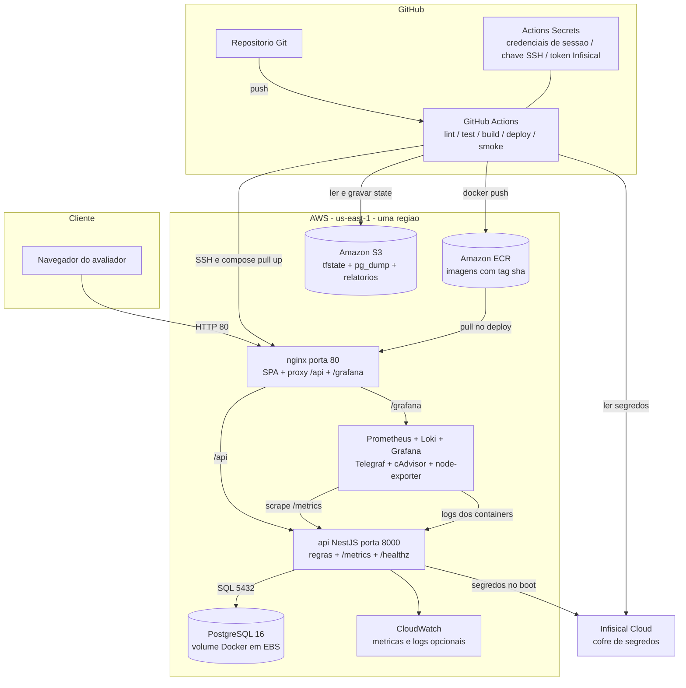
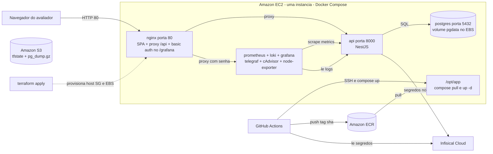
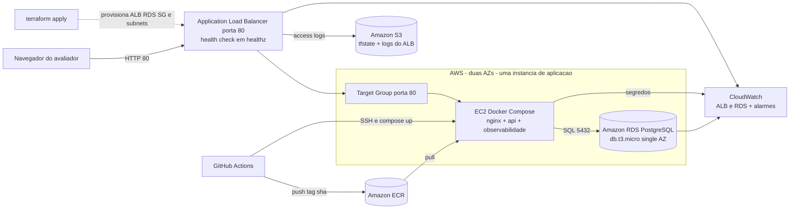
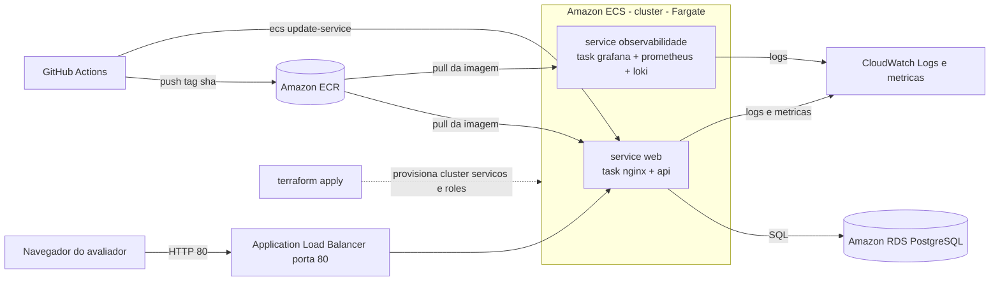
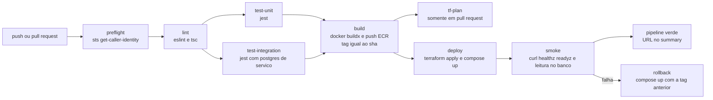
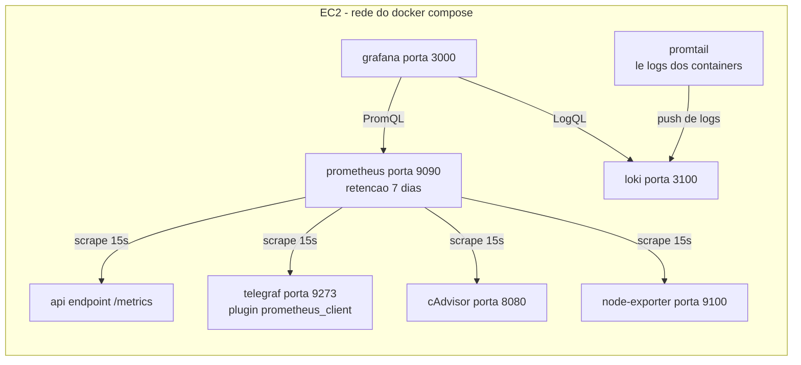

# Análise de Requisitos e Arquitetura — Projeto 2

**Disciplina:** Computação em Nuvem · **UFRPE** — Projeto Integrador: Desenvolvimento e Implantação em Nuvem
**Versão:** 1.0 (revisada pelo coordenador) · **Data:** 2026-11-14
**Fontes:** `docs/00-edital-projeto-2.md` (edital) e `docs/02-aws-academy-limites-e-riscos.md` (limites do sandbox).
**Fora de escopo deste documento:** arquivos `.tf`, código da aplicação, instalação de ferramentas (ver `docs/03-guia-pre-requisitos.md`), cronograma por fases (`docs/04`).

> **Como ler.** O edital é a fonte de verdade do que é exigido (`docs/00`). As restrições de
> plataforma aqui declaradas na §1.2 estão detalhadas e marcadas por grau de confiança em
> `docs/02`; onde `docs/02` diz "confirmar no laboratório", este documento trata como
> **suposição** (§9), nunca como fato.

## 0. Sumário executivo

- **75% da nota** estão em quatro critérios: aplicação (25%), serviços AWS (20%), Terraform (15%) e pipeline (15%). O restante (25%) é barato de obter, mas fácil de perder por descuido.
- **Nenhum critério premia** alta disponibilidade, escalabilidade horizontal, banco gerenciado ou Kubernetes. O edital é explícito: "a avaliação não será baseada apenas na quantidade de serviços" (§7 do edital).
- O ambiente é um sandbox de **credenciais temporárias e créditos finitos**: recurso que cobra por hora parada (ALB, RDS) compra **risco**, não nota.
- **Recomendação: Opção 1** — uma EC2 com Docker Compose (app + observabilidade), imagem no ECR, `tfstate` no S3, segredos no Infisical Cloud, deploy por SSH no GitHub Actions. ALB e RDS ficam como *upgrades*, condicionados à §9 e ao professor (§10).
- Consequência aceita: sem HA, sem TLS de domínio próprio, banco não gerenciado, observabilidade no mesmo host da aplicação.

## 1. Contexto e restrições

### 1.1 O que o edital exige, em quatro blocos

| Bloco | Conteúdo | Peso agregado |
| --- | --- | --- |
| Aplicação | Frontend + backend + persistência, funcionalidades reais, arquitetura documentada, demo em nuvem (§2, §3.1, §5) | 25% |
| Plataforma AWS | Implantação obrigatória na AWS, serviços escolhidos e justificados (§4) | 20% |
| Automação | Terraform versionado (§3.2), pipeline com testes/build/deploy/verificação pós-deploy (§3.3), testes integrados (§3.5) | 40% |
| Confiança e prova | Segredos (§3.4), observabilidade (§3.6), documentação incl. remoção de recursos (§3.7) | 15% |

### 1.2 Restrições de plataforma assumidas

Detalhamento, comandos de verificação e grau de confiança: `docs/02-aws-academy-limites-e-riscos.md`.

1. Acesso via **AWS Academy Learner Lab**: credenciais de sessão temporárias (`AWS_ACCESS_KEY_ID` + `AWS_SECRET_ACCESS_KEY` + `AWS_SESSION_TOKEN`) que expiram ao fim da sessão (`docs/02` §2).
2. **IAM restrito**: não se cria role/policy/instance profile arbitrário; existem `LabRole` / `LabInstanceProfile` pré-criados. Consequência: **nada de OIDC do GitHub**, nada de role por serviço (`docs/02` §4 e §8).
3. **Orçamento de créditos limitado** e região possivelmente fixa em `us-east-1` (`docs/02` §5).
4. Sem domínio próprio: **Route 53 (registro) + ACM + HTTPS com certificado válido ficam fora**; a entrega é por IP público ou DNS do ALB, em HTTP (`docs/02` §3.1, item 7).
5. **Persistência entre sessões**: os recursos criados permanecem na conta entre sessões do lab; o que expira são as credenciais (`docs/02` §6). A consequência de desenho é a oposta à intuitiva: **recurso ocioso continua consumindo crédito**, então a rotina de `destroy` é obrigatória.

### 1.3 Ambiente local e o que ele decide

Windows 11; **WSL2 com Ubuntu instalado e funcionando**; Docker Desktop + Compose; git, ssh, Python 3.13, VS Code, `winget` e `scoop` disponíveis. **Não instalados ainda:** AWS CLI, Terraform e Ansible (passo a passo em `docs/03-guia-pre-requisitos.md`). Isso fixa quatro decisões:

- **Terraform roda no WSL (ciclo local) e no runner do GitHub Actions (pipeline).** O WSL é o ambiente principal de operação; o runner é o que torna a infraestrutura reproduzível e auditável (reforça §3.2).
- **A imagem Docker é construída no pipeline**; o Docker Desktop serve ao desenvolvimento local (§3.3).
- **Ansible é descartado**, com justificativa registrada: `user_data`/cloud-init + Docker Compose versionado cobrem o mesmo caso com menos superfície, e o edital permite omitir ferramentas listadas mediante justificativa (§4 do edital). Vira opção de evolução, não requisito.
- **Node 22 + TypeScript locais são o ambiente do backend** (NestJS; ADR-007 em `docs/app/02-arquitetura.md`), o que mantém um só idioma entre backend e frontend e o ciclo de desenvolvimento curto (§6).

### 1.4 Convenção de identificadores

O edital não usa a expressão "8 requisitos"; este documento consolida **R1–R8** a partir das seções 3.1–3.7 mais a obrigação de plataforma da §4:

| ID | Requisito consolidado | Origem | Critério |
| --- | --- | --- | --- |
| R1 | Aplicação funcional com frontend, backend e persistência | §3.1 | C1 |
| R2 | Infraestrutura como código em Terraform, versionada | §3.2 | C3 |
| R3 | Pipeline CI/CD com testes, artefato, deploy e verificação pós-deploy | §3.3 | C4 |
| R4 | Gestão de segredos e credenciais | §3.4 | C6 |
| R5 | Testes automatizados integrados ao pipeline | §3.5 | C5 |
| R6 | Observabilidade: métricas, logs e visualização | §3.6 | C7 |
| R7 | Documentação técnica, incluindo remoção de recursos | §3.7 | C8 |
| R8 | Implantação na AWS com serviços integrados e justificados | §4 | C2 |

## 2. Rastreabilidade: requisito → evidência → peso

### 2.1 Requisitos técnicos (§3.1 a §3.7)

| ID | Exigência (verbo do edital) | O que precisa existir no projeto | Evidência que comprova | Peso afetado |
| --- | --- | --- | --- | --- |
| R3.1.1 | *deverá* implementar funcionalidades compatíveis com o problema | Domínio com CRUD e ao menos uma regra não trivial (§8) | app pública + README com casos de uso + seed | 25% (C1) |
| R3.1.2 | *deverá* ter arquitetura documentada com componentes e interações | Diagrama de componentes, contratos e decisões | este documento §3–§5 + ADRs | 25% (C1) e 5% (C8) |
| R3.1.3 | *deverá* usar mecanismo adequado de persistência | Postgres com schema versionado, volume persistente e backup | `migrations/`, `compose.yaml`, job de `pg_dump` para S3 | 25% (C1) |
| R3.1.4 | *deverá* rodar em nuvem e permitir demonstrar funcionamento | URL pública viva + roteiro de demonstração de 3 minutos | seção "Demo" no README + smoke test + capturas | 20% (C2) e 25% (C1) |
| R3.2.1 | *deverá* usar Terraform para os principais recursos, "incluindo os necessários para execução e sua comunicação" | Compute, rede (SG), armazenamento, registry e backend de estado | diretório `infra/` + `terraform plan` no log do pipeline | 15% (C3) |
| R3.2.2 | *deverão* estar versionados no repositório Git | Sem `tfstate`/`.tfvars` sensíveis no Git; backend remoto | `.gitignore`, histórico, `terraform fmt -check` e `validate` no CI | 15% (C3) e 5% (C6) |
| R3.3.1 | *deverá* verificar o código e executar testes automatizados | Lint + testes unitários + integração | jobs `lint`, `test-unit`, `test-integration` verdes | 15% (C4) e 10% (C5) |
| R3.3.2 | *deverá* construir e disponibilizar os artefatos | Imagem no ECR com tag = SHA do commit + relatórios | job `build`, digest publicado como artefato do workflow | 15% (C4) |
| R3.3.3 | *deverá* implantar de forma automatizada | Deploy sem passo manual após merge | job `deploy` com log do `compose pull/up` | 15% (C4) |
| R3.3.4 | *deverá* verificar o resultado, "incluindo verificação automatizada de disponibilidade após o deploy" | Smoke test que falha o workflow em erro | job `smoke` + summary com URL e status | 15% (C4) e 10% (C5) |
| R3.4.1 | *deverá* gerenciar credenciais, tokens e senhas | Cofre com ambientes e identidade de máquina | config do Infisical + runbook de rotação | 5% (C6) |
| R3.4.2 | credenciais *não devem* estar no código ou em arquivos versionados | `.env.example` sem valores, `.gitignore`, varredura de segredos | job `gitleaks` verde + histórico limpo | 5% (C6) |
| R3.4.3 | credenciais *devem* ser disponibilizadas de forma segura, sem exposição em logs, código ou artefatos públicos | Mascaramento, injeção em runtime, artefato sem segredo | §7.5 + log do pipeline sem valores | 5% (C6) |
| R3.5.1 | *deverá* contemplar testes unitários, de integração ou de API | Ao menos dois níveis, com banco real na integração | `tests/unit`, `tests/integration`, relatório de cobertura | 10% (C5) |
| R3.5.2 | *deverão* estar integrados ao pipeline | Execução automática em push e PR | workflow + aba Checks do PR | 10% (C5) e 15% (C4) |
| R3.5.3 | *deverá* explicar como os resultados influenciam a continuidade da implantação | Grafo de jobs com dependências explícitas, documentado | §6.3 + seção "Como os testes bloqueiam o deploy" no README | 10% (C5) |
| R3.6.1 | *deverá* coletar métricas (requisições, disponibilidade, tempo de resposta) | Endpoint `/metrics` + coleta + painel | dashboard + aba *Targets* do Prometheus com todos UP | 5% (C7) |
| R3.6.2 | *deverá* registrar operações e erros | Log estruturado em JSON + coleta centralizada | consulta de erro no Grafana + amostra de log | 5% (C7) |
| R3.6.3 | *deverá* permitir consultar métricas e logs por dashboards | Grafana provisionado por arquivo (versionado) | dashboard no repositório + print no README | 5% (C7) |
| R3.7.1 | *deverá* documentar aplicação, arquitetura, tecnologias e decisões | README + este documento + ADRs + justificativa das escolhas | `docs/` | 5% (C8) |
| R3.7.2 | *deverá* documentar procedimentos de execução, **implantação e remoção** | Runbook: subir, implantar, destruir, encerrar sessão do lab | doc de operação + workflow `destroy` com confirmação | 5% (C8) e 15% (C3) |

### 2.2 Entregáveis (§6)

| ID | Entregável | Como será comprovado | Onde pontua |
| --- | --- | --- | --- |
| E1 | Proposta inicial (problema, funcionalidades, arquitetura preliminar, tecnologias) | §8 deste documento + apresentação na aula de acompanhamento | Habilita o projeto (sem nota direta; condiciona C1 e C2) |
| E2 | Repositório com código, testes, IaC, automação e documentação | estrutura única com `app/`, `infra/`, `.github/`, `docs/`, `observability/` | C1, C3, C5, C8 |
| E3 | Pipeline CI/CD funcional com evidências de testes, build e deploy | histórico de execuções verdes + artefatos (JUnit XML, cobertura, digest) | C4 e C5 |
| E4 | Aplicação implantada (ambiente funcional na nuvem) | URL pública + smoke test verde + capturas datadas | C1 e C2 |
| E5 | Documentação técnica (arquitetura, decisões, execução, implantação, segurança, observabilidade) | README + `docs/` completo | C8 |

### 2.3 Critérios de avaliação (§7) e o que move a nota

| ID | Critério | Peso | O que realmente move a nota | Coberto por |
| --- | --- | --- | --- | --- |
| C1 | Desenvolvimento da aplicação | 25% | Funcionalidade real demonstrável, regra de negócio testável, UI que um leigo opera | R3.1.1–R3.1.4, §8 |
| C2 | Utilização e integração dos serviços AWS | 20% | Serviços **integrados** (não contados) e justificados; app viva na AWS | R8, §4–§5 |
| C3 | Terraform | 15% | Ciclo completo provisionar/alterar/destruir com estado remoto e código legível | R3.2.1–R3.2.2, R3.7.2 |
| C4 | Pipeline CI/CD | 15% | Quatro etapas exigidas visíveis no histórico, com deploy sem intervenção | R3.3.1–R3.3.4, §6.3 |
| C5 | Testes automatizados e qualidade | 10% | Dois níveis de teste e explicação do gate | R3.5.1–R3.5.3 |
| C6 | Segurança e gerenciamento de segredos | 5% | Nenhum segredo rastreável no Git/log/artefato; cofre usado de fato | R3.4.1–R3.4.3, §7 |
| C7 | Observabilidade | 5% | Métrica, log e dashboard funcionando no ar, com coleta explicada | R3.6.1–R3.6.3, §7 |
| C8 | Documentação técnica | 5% | Clareza e completude, incluindo remoção | R3.1.2, R3.7.1–R3.7.2, E5 |

### 2.4 Requisitos transversais (§4 e §5)

| ID | Exigência | O que precisa existir | Evidência | Peso afetado |
| --- | --- | --- | --- | --- |
| R4.1 | Implantação *deverá* usar AWS; ferramentas escolhidas *deverão* ser justificadas | Toda a arquitetura na AWS, com justificativa por serviço e por ferramenta omitida | §4, §5 e §6.4 | 20% (C2) |
| R5.1 | Repositório Git com histórico que permita acompanhar a evolução | Commits pequenos, branches e PRs | `git log`, PRs | 15% (C3) e 15% (C4) |
| R5.2 | Divisão de tarefas documentada, com todos conhecendo a arquitetura | Seção "Equipe e divisão" no README | README | 5% (C8) |

### 2.5 Leitura dos pesos (o que decide o projeto)

- **C1 + C2 + C3 + C4 = 75%.** Investimento em infraestrutura sofisticada só vale se não roubar tempo de C1.
- **C2 vale 20% por *integração*, não por *quantidade*** — citação literal do §7: "A avaliação não será baseada apenas na quantidade de serviços". Quatro serviços bem integrados e explicados empatam com dez serviços mal costurados.
- **C5 (10%) é consequência de C1**: testes só existem se houver domínio; por isso a escolha do tema (§8) precede a escolha da arquitetura.
- **C6 + C7 + C8 = 15%** e são obtidos quase sem custo incremental **se** estiverem no desenho desde o início (é o caso deste documento).

## 3. Mapa de capacidades

### 3.1 Componentes e responsabilidades

| Componente | Responsabilidade | Depende de | É dependência de | Se falhar, compromete |
| --- | --- | --- | --- | --- |
| UI (SPA) | Operar o domínio: listar, criar, editar, filtrar; estados de erro e carregamento | API (contrato OpenAPI) | Demonstração (R3.1.4) | C1, E4 |
| Borda / reverse proxy | Servir a SPA, rotear `/api`, proteger `/grafana` com autenticação, ponto único de entrada na porta 80 | Nenhum (é o primeiro) | UI, API, Grafana | C1, C7 |
| API | Regras de negócio, validação, autorização, `/metrics`, `/healthz`, `/readyz` | Postgres, Segredos | UI, smoke test, Prometheus | C1, C4, C7 |
| Persistência | Estado do domínio, integridade referencial, histórico de migrations | Volume EBS | API, testes de integração | C1, C5 |
| Autenticação | Identidade de usuário (JWT próprio), senha com hash, sessão | Persistência, Segredos | UI, API | C1 |
| Segredos | Guardar e distribuir senha do banco, chave JWT, token do Infisical, senha do Grafana | Infisical, Actions Secrets | API, Grafana, deploy | C6 |
| Observabilidade | Medir (Prometheus/Telegraf), registrar (Loki), visualizar (Grafana) | API, containers, disco | Demonstração de C7 | C7 |
| CI/CD | Lint, testes, build, push, deploy, smoke | Repositório, Actions Secrets, ECR, EC2 | Entrega (E3) | C4, C5 |
| IaC | Criar e destruir EC2, SG, EBS, ECR, S3, (ALB, RDS) | Credenciais AWS, backend S3 | CI/CD (deploy de infra), operação | C3 |
| Artefatos e backup | `tfstate`, `pg_dump`, logs do ALB, relatórios de teste | S3 | IaC, persistência | C3, C1 |

### 3.2 Dependências (visão de implantação)

### 3.3 Fronteiras e o *seam* que permite trocar de opção

Três contratos explícitos isolam as mudanças de arquitetura:

1. **UI ↔ API:** OpenAPI gerado pelo backend; a SPA consome só o que está no contrato, e o teste de API usa o mesmo contrato.
2. **API ↔ Banco:** schema só muda por migration versionada; nenhum `CREATE TABLE` em código de aplicação.
3. **IaC ↔ Pipeline:** o pipeline lê `terraform output -json` e usa apenas quatro saídas — `host_public_ip` (ou `alb_dns_name`), `ecr_repository_url`, `state_bucket`, `target_port`. **Trocar a borda (IP → ALB → ECS) muda uma saída, não o workflow.** É esse *seam* que torna a recomendação da §5 reversível a custo baixo.

### 3.4 Capacidades deliberadamente fora do desenho

Cognito, autoscaling, multi-AZ, EKS/Kubernetes, Route 53/ACM/HTTPS, CloudFront, Ansible, runner auto-hospedado. Cada uma adiciona superfície de falha e/ou custo sem peso correspondente no edital; a justificativa individual está na §6.4.

## 4. Opções de arquitetura

### 4.1 Critérios de comparação e a regra do custo ocioso

Todas as opções são avaliadas nos mesmos nove eixos: **(a)** diagrama, **(b)** serviços AWS, **(c)** custo em créditos, **(d)** o que o Terraform cria, **(e)** onde o pipeline faz deploy, **(f)** aderência aos 8 requisitos, **(g)** exigências ao sandbox, **(h)** curva de risco, **(i)** esforço.

> **Regra de decisão — custo ocioso.** ALB e RDS são cobrados por hora **enquanto existem**, com ou sem tráfego; a instância EC2 só é cobrada enquanto está ligada. E os recursos **persistem** entre sessões do lab (`docs/02` §6), então o que foi criado num dia continua cobrando no dia seguinte, mesmo sem demo. O critério não é "quanto custa a demo", é **"quanto custa por dia sem demo"**.
>
> Custo fixo comum a todas: endereço IPv4 público é cobrado por hora em qualquer configuração atual da AWS, com ou sem Elastic IP — não diferencia as opções, mas entra no orçamento.
>
> Preços absolutos não são citados aqui de propósito: variam por região e por época, e a disponibilidade de saldo está em `docs/02` §5. A comparação é **relativa e ordenada**.

### 4.2 Opção 1 — EC2 única com Docker Compose

**(a) Diagrama**

**(b) Serviços AWS:** EC2 (1 instância, `t3.small` com 2 GB ou `t3.medium` com 4 GB se a stack de observabilidade subir junto), EBS `gp3` (~30 GB), Amazon ECR (1 repositório de imagens), Amazon S3 (estado do Terraform + `pg_dump`), CloudWatch (opcional: log de boot/alarme de status), IAM apenas como **referência** a `LabRole`/`LabInstanceProfile` pré-existentes.

**(c) Custo em créditos: BAIXO (referência 1×).** Custo dominante = horas de EC2 enquanto ligada. Fora da sessão, o gasto residual é EBS + armazenamento de imagem + alguns MB no S3 — ou seja, **quase zero quando a instância para**. Justificativa: nenhum recurso de cobrança horária sempre-ligada.

**(d) O que o Terraform cria:** provider e *lockfile*; backend S3 (`use_lockfile = true` quando a versão suportar, dispensando DynamoDB); bucket de estado com versionamento e bloqueio de acesso público; *security group* (80 aberto; 22 restrito — ver §4.2g); `aws_instance` com `user_data` (instala Docker e Compose plugin, cria `/opt/app`, registra um serviço `systemd` de `compose up`); volume EBS de dados; repositório ECR com *lifecycle policy* de 5 imagens; *key pair* (criada ou reaproveitada, ver `docs/02` §10); `outputs` (`host_public_ip`, `ecr_repository_url`, `state_bucket`). **Não cria** role, policy, ALB, RDS.

**(e) Onde o pipeline faz deploy:** `build` empurra a imagem para o ECR com tag = SHA; `deploy` executa `terraform apply` (quando `infra/` mudou) e, em seguida, SSH na instância → `docker compose pull && docker compose up -d && docker compose exec -T api pnpm prisma migrate deploy`. O runner descobre o IP pela saída do Terraform, nunca por valor fixo.

**(f) Aderência aos 8 requisitos**

| Req | Como a Opção 1 cumpre | Veredito |
| --- | --- | --- |
| R1 Aplicação | Mesma aplicação das demais opções; única diferença é a borda | Atende |
| R2 Terraform | 100% dos recursos usados são criados por Terraform, com estado remoto | Atende |
| R3 CI/CD | Quatro etapas no Actions; deploy por SSH é automatizado e auditável no log | Atende |
| R4 Segredos | Infisical Cloud + Actions Secrets; `.env` gerado no host com permissão 600 e fora do Git | Atende |
| R5 Testes | Idêntico às demais (testes não dependem da topologia) | Atende |
| R6 Observabilidade | É a opção **mais simples** para R6: tudo em um `compose.yaml`, sem rede entre serviços | Atende |
| R7 Documentação | Superfície pequena: um runbook cobre subir, implantar, destruir | Atende |
| R8 AWS | EC2 + ECR + S3 + CloudWatch integrados (imagem, estado, backup, métricas) | Atende |

**(g) Exigências ao sandbox restrito:** A1 (credenciais exportáveis), A2 (EC2/ECR/S3/SG/key pair), A3 (`LabInstanceProfile` com leitura de ECR), A6 (instância para e é localizável), A9 (SSH 22 do runner, saída para internet), A14 (bucket de estado). **Não exige** RDS, ALB, ECS nem `iam:PassRole` — é a opção que ativa o menor conjunto de incógnitas.

**(h) Curva de risco — o que costuma quebrar**

1. **OOM / disco cheio** em `t3.micro` com Prometheus + Loki + Postgres no mesmo host → *mitigação*: `t3.small` no mínimo, `mem_limit` por serviço, retenção de 7 dias, alerta de disco > 80%.
2. **Primeiro boot silencioso**: `user_data` falha e ninguém vê → *mitigação*: log em `/var/log/cloud-init-output.log` no EBS, `systemd` com restart, smoke test que denuncia na hora.
3. **Credenciais de sessão expiradas no meio do `apply`** → estado parcial → *mitigação*: job `preflight` com `sts get-caller-identity` que falha rápido e mensagem clara; `apply` idempotente e reexecutável (`docs/02` §2.6).
4. **SSH 22 aberto ao mundo** (IPs dos runners do GitHub são dinâmicos) → *mitigação*: autenticação só por chave, `fail2ban`, e a alternativa documentada de deploy *pull-based* (timer no host puxando do ECR via instance profile).
5. **Host "pet"**: alteração feita à mão some no próximo `apply` → *mitigação*: regra de que todo ajuste vira `user_data`/compose versionado; `docker compose` sempre a partir do repositório.

**(i) Esforço estimado: 8–12 pessoa-dia** (app 5–7, testes 2, infra+deploy+observabilidade+docs 1–3).

### 4.3 Opção 2 — EC2 + ALB + RDS + ECR

**(a) Diagrama**

**(b) Serviços AWS:** ALB + target group + listener, EC2 (1 instância de aplicação), RDS PostgreSQL `db.t3.micro`/`db.t4g.micro` single-AZ (~20 GB), ECR, S3 (estado + *access logs* do ALB), CloudWatch (métricas de ALB/RDS e 2–3 alarmes), VPC default com 2 subnets em AZs distintas, IAM por referência (`LabInstanceProfile`).

**(c) Custo em créditos: MÉDIO-ALTO (ordem de 3–5× a Opção 1 em regime ocioso).** Custo dominante: ALB cobrado por hora enquanto provisionado + instância e armazenamento de RDS 24/7 + EC2. Justificativa: dois recursos que não param de cobrar quando a aplicação para, e a criação de RDS leva vários minutos por `apply`, multiplicando o consumo por tentativa.

**(d) O que o Terraform cria:** tudo da Opção 1, mais VPC/subnets (ou descoberta das *default*), 2 SGs encadeados (ALB → instância, ninguém entra direto na instância), ALB + listener + target group com *health check* em `/healthz`, `aws_db_subnet_group`, `aws_db_instance` com senha vinda de variável sensível, S3 de *access logs* com política de bucket, alarmes CloudWatch. **Não cria** role: usa `LabRole`.

**(e) Onde o pipeline faz deploy:** igual à Opção 1 (ECR → SSH → compose). O ALB adiciona o *health check* como segunda barreira: o `smoke` roda contra o DNS do ALB, e uma versão quebrada derruba o target antes de o smoke falhar.

**(f) Aderência aos 8 requisitos**

| Req | Como a Opção 2 cumpre | Veredito |
| --- | --- | --- |
| R1 Aplicação | Mesma aplicação | Atende |
| R2 Terraform | Mais recursos, mais chance de `apply` parcial sob credencial expirada | Atende com ressalva |
| R3 CI/CD | Deploy idêntico; ALB melhora a detecção de falha pós-deploy | Atende |
| R4 Segredos | Pode usar Secrets Manager para a senha do RDS, **se** permitido (A11) | Atende |
| R5 Testes | Idêntico | Atende |
| R6 Observabilidade | Stack na instância + métricas de ALB/RDS no CloudWatch = painel mais rico | Atende |
| R7 Documentação | Superfície maior: rede, banco e alarmes a documentar | Atende |
| R8 AWS | Seis serviços integrados — a maior pontuação potencial em C2 | Atende |

**(g) Exigências ao sandbox restrito:** A1, A2, A3, A6, A9, A14 **mais** A4 (RDS disponível), A5 (ALB + 2 subnets em AZs distintas), A12 (crédito). Ativa 5–6 incógnitas críticas em vez de 3.

**(h) Curva de risco — o que costuma quebrar**

1. **Health check divergente** (app responde 302 ou 401 em `/healthz`, ALB marca *unhealthy*) → *mitigação*: endpoint dedicado sem autenticação e *matcher* 200 explícito.
2. **`apply` de RDS demora 8–15 min** e pode estourar a vida da credencial de sessão → *mitigação*: aplicar a infraestrutura em execuções separadas com `-target` e reexecutar (idempotente).
3. **RDS/AZ**: `db_subnet_group` precisa de 2 subnets em AZs distintas; se o VPC default do lab tiver só uma AZ utilizável, a criação falha → *mitigação*: verificar antes (A5) e ter a Opção 1 como plano B imediato.
4. **Custo ocioso** consumindo o orçamento antes da apresentação → *mitigação*: workflow `destroy` para ALB/RDS, ou só recriá-los na véspera da demo.
5. **Banco público por descuido** (SG `0.0.0.0/0` na 5432) → *mitigação*: SG do RDS aceita apenas o SG da instância; *publicly accessible = false*.

**(i) Esforço estimado: 15–20 pessoa-dia** (app 5–7, testes 2, infra+rede+banco+alarmes 5–7, observabilidade+docs 3).

### 4.4 Opção 3 — Contêiner gerenciado (ECS/Fargate ou App Runner)

**(a) Diagrama**

Variante **App Runner**: elimina ALB e cluster, mas perde compose, perde SSH e complica o acesso ao RDS (conector VPC); a observabilidade fica limitada ao CloudWatch — pior para C7.

**(b) Serviços AWS:** ECS cluster + Fargate, 2 *task definitions* + 2 *services* (ou App Runner + 1 serviço de observabilidade), ALB, RDS, ECR, CloudWatch Logs + métricas, VPC/subnets, e **`LabRole` passada como *execution role* e *task role*** via `iam:PassRole`.

**(c) Custo em créditos: ALTO (ordem de 4–7× a Opção 1).** Custo dominante: Fargate cobra por vCPU-hora e GB-hora **por tarefa em execução**; com no mínimo uma tarefa de aplicação e uma de observabilidade, mais ALB e RDS, o gasto é contínuo e proporcional ao número de tarefas. Justificativa: três camadas de cobrança horária simultâneas (compute gerenciado + ALB + RDS) para um tráfego de demonstração.

**(d) O que o Terraform cria:** cluster, *task definitions* com `networkMode awsvpc`, serviços com `desired_count = 1`, *security groups*, ALB + target group, log groups, RDS + subnet group, ECR, e **duas referências a recursos pré-existentes** (`data "aws_iam_role" "lab"`), nunca criação de role. É o maior grafo de recursos das três opções.

**(e) Onde o pipeline faz deploy:** `aws ecs update-service --force-new-deployment` seguido de `aws ecs wait services-stable`, ou um `terraform apply` que muda a revisão da *task definition*. O smoke test roda contra o DNS do ALB. Se `ecs:UpdateService` não estiver liberado no lab, o deploy cai para `terraform apply` (mais lento, ainda automatizado).

**(f) Aderência aos 8 requisitos**

| Req | Como a Opção 3 cumpre | Veredito |
| --- | --- | --- |
| R1 Aplicação | Mesma aplicação, empacotada como tarefa | Atende |
| R2 Terraform | Grafo maior; depende de permissões que o lab pode negar (`iam:PassRole`) | Risco de não atender |
| R3 CI/CD | `update-service` exige permissões; alternativa por `apply` dói no tempo | Atende com ressalva |
| R4 Segredos | Injeção nativa de Secrets Manager/SSM na *task definition* — elegante, **se** permitido (A11) | Atende com ressalva |
| R5 Testes | Idêntico | Atende |
| R6 Observabilidade | Fargate só entrega logs no CloudWatch; Grafana/Prometheus exigem outra tarefa e mais crédito | Atende com custo alto |
| R7 Documentação | Muito mais superfície: cluster, revisões, roles, rede | Atende |
| R8 AWS | Sete serviços integrados, o teto teórico de C2 — mas só se tudo puder ser criado | Risco de não atender |

**(g) Exigências ao sandbox restrito:** todas as anteriores **mais** A7 (`iam:PassRole` sobre `LabRole`), A8 (ECS/App Runner disponível), A13 (limite de vCPU/tarefas). É a opção com **maior chance de parar em um erro de permissão** — o modo de falha mais caro em um sandbox, porque não é contornável por código.

**(h) Curva de risco — o que costuma quebrar**

1. **`AccessDenied` em `iam:PassRole` ou `ecs:RegisterTaskDefinition`** — bloqueio duro, sem contorno dentro do lab.
2. **Serviço que não estabiliza** (task reiniciando em loop por falta de variável de ambiente, imagem errada ou porta divergente) — diagnóstico mais lento que em Docker Compose, porque não há shell no host.
3. **Rede `awsvpc`**: SG por tarefa, subnets públicas + IP público ou NAT (NAT Gateway custa por hora — mais queima de crédito).
4. **Observabilidade cara ou ausente**: Prometheus em Fargate perde descoberta trivial; cada tarefa extra é custo fixo.
5. **Cold start e tempo de deploy** alongam o ciclo de feedback, justamente no critério C4 (15%).

**(i) Esforço estimado: 20–26 pessoa-dia** (app 5–7, testes 2, infra cluster/rede/roles 8–11, observabilidade+docs 5).

### 4.5 Tabela comparativa final

| Dimensão | Opção 1 — EC2 + Compose | Opção 2 — EC2 + ALB + RDS | Opção 3 — ECS/Fargate |
| --- | --- | --- | --- |
| R1 Aplicação (25%) | Atende | Atende | Atende |
| R2 Terraform (15%) | Atende | Atende com ressalva | Risco de não atender |
| R3 CI/CD (15%) | Atende | Atende | Atende com ressalva |
| R4 Segredos (C6 5%) | Atende | Atende | Atende com ressalva |
| R5 Testes (C5 10%) | Atende | Atende | Atende |
| R6 Observabilidade (5%) | Atende | Atende | Atende com custo alto |
| R7 Documentação (5%) | Atende | Atende | Atende |
| R8 AWS integrado (20%) | Atende com 4 serviços | Atende com 6 serviços | Atende com 7 serviços, se permitido |
| Requisitos atendidos | **8 de 8** | 7–8 de 8 | 5–8 de 8 (dependente de permissão) |
| Custo em créditos | **Baixo (1×)** | Médio-alto (3–5×) | Alto (4–7×) |
| Custo quando ocioso | EBS + S3 + ECR | + ALB + RDS por hora | + Fargate + ALB + RDS por hora |
| Risco de execução | Baixo-médio | Médio-alto | Alto |
| Esforço (pessoa-dia) | **8–12** | 15–20 | 20–26 |
| Aderência a sandbox restrito | **Alta** (3 suposições críticas) | Média (5) | Baixa (7) |
| Suposições ativadas (§9) | A1, A2, A3, A6, A9, A14 | + A4, A5, A12 | + A4, A5, A7, A8, A12, A13 |

### 4.6 Matriz ponderada: peso × risco × esforço

Notas de 0 a 5 por critério, **julgamento declarado** (não medição), usando os pesos do §7 do edital. O "fator de conclusão" é a probabilidade qualitativa de entregar **todos** os critérios no prazo e no orçamento, derivada do esforço estimado e do número de suposições cuja falsidade exigiria retrabalho alto (Opção 1: 3; Opção 2: 5; Opção 3: 7).

| Critério | Peso | Op. 1 | Op. 2 | Op. 3 | Por quê |
| --- | --- | --- | --- | --- | --- |
| C1 Aplicação | 25% | 5 | 5 | 5 | Mesma aplicação nas três |
| C2 Serviços AWS | 20% | 3 | 5 | 5 | Amplitude de serviços integrados |
| C3 Terraform | 15% | 5 | 4 | 3 | Grafo maior = mais chance de apply parcial |
| C4 CI/CD | 15% | 5 | 4 | 3 | Deploy por SSH é o mais simples de provar |
| C5 Testes | 10% | 5 | 5 | 5 | Independe da topologia |
| C6 Segredos | 5% | 4 | 5 | 4 | Secrets Manager ajuda, se liberado |
| C7 Observabilidade | 5% | 5 | 5 | 3 | Observabilidade gerenciada custa crédito |
| C8 Documentação | 5% | 4 | 5 | 4 | Mais serviços = mais a documentar |
| **Média ponderada** | 100% | **4,50** | **4,70** | **4,20** | — |
| Fator de conclusão | — | 0,95 | 0,72 | 0,50 | Esforço × suposições críticas |
| **Nota esperada** | — | **4,28** | **3,38** | **2,10** | Média ponderada × fator |

A leitura que importa: a Opção 2 ganha **0,20** de média bruta (quase tudo em C2) e perde **0,23** de fator — a troca é desfavorável quando o tempo é o recurso escasso. A Opção 1 tem a maior nota esperada e a menor variância.

## 5. Recomendação

### 5.1 Decisão

**Adotar a Opção 1 — EC2 única com Docker Compose**, complementada por Amazon ECR (artefato), Amazon S3 (estado do Terraform e backup lógico do banco), CloudWatch (mínimo) e Infisical Cloud (segredos). Manter, desde o primeiro commit, o *seam* da §3.3 (saídas do Terraform) para que ALB e RDS possam ser adicionados sem reescrever o pipeline.

**Justificativa rastreável ao edital**

1. **C1 (25%) + C3 (15%) + C4 (15%) + C5 (10%) = 65% da nota** são integralmente obteníveis na Opção 1; nenhum deles exige ALB, RDS ou orquestrador.
2. **C2 (20%) exige integração, não quantidade** — §7 do edital, literalmente: "a avaliação não será baseada apenas na quantidade de serviços". Quatro serviços integrados (EC2, ECR, S3, CloudWatch) sustentam C2 sem os recursos que queimam crédito.
3. **§4 do edital** afirma que "não é necessário utilizar todos os serviços listados"; a omissão de RDS/ALB/ECS é legítima **desde que justificada** — e a justificativa é a restrição de sandbox e de orçamento (§1.2, §9).
4. **Custo ocioso é risco de nota, não só de bolso**: estourar créditos antes da apresentação derruba C1 (demo) e C2 (aplicação no ar). A Opção 1 minimiza o gasto nas horas sem demo.
5. **A Opção 1 também é a de menor esforço (8–12 pd)**, e o tempo economizado volta para C1, o critério mais pesado.

### 5.2 Por que as outras perdem

- **Opção 2 (EC2 + ALB + RDS):** compra +2 pontos em C2 ao custo de ALB e RDS cobrando por hora **mesmo sem tráfego**, `apply` de banco em 8–15 min sob credencial de sessão, e um requisito de rede (2 subnets em AZs distintas) que o lab pode não oferecer. Com **uma** instância de aplicação, o ALB **não** entrega alta disponibilidade nem deploy sem queda — entrega DNS estável e *health check*. Paga-se por atributos que o edital não pontua. 7–10 pessoa-dia a mais → menos tempo em C1.
- **Opção 3 (ECS/Fargate ou App Runner):** teto teórico em C2 (7 serviços), mas o caminho passa por `iam:PassRole`, `ecs:*` e limites de vCPU — permissões que um Learner Lab pode simplesmente negar. Falha em sandbox é **falha sem contorno**; além disso, observabilidade em Fargate custa mais caro e entrega menos que a mesma stack em Compose (C7). Maior esforço, maior variância.
- **Status quo (não construir / entregar só documentação):** não é uma opção real — o edital exige aplicação implantada (E4, §3.1) e pipeline funcional (E3, §3.3); sem isso, C1, C2 e C4 vão a zero.

### 5.3 Trade-offs aceitos

1. **Sem alta disponibilidade e sem balanceamento.** Instância única = ponto único de falha; redeploy implica indisponibilidade de segundos a poucos minutos. Aceito porque nenhum critério premia HA e a demo é agendada.
2. **Banco não gerenciado.** Postgres em container com volume EBS: sem *point-in-time recovery* e sem *patching* automático. Compensação parcial: `pg_dump` diário para S3 e script de restauração documentado (cobre C1 e C3, não cobre RPO de segundos).
3. **HTTP sem domínio próprio e sem TLS.** Consequência direta de não haver Route 53/ACM no sandbox. Aceito e documentado como limitação de ambiente, com mitigação de não trafegar dado sensível real e senhas fortes no Grafana.
4. **SSH exposto aos runners do GitHub** (IP de origem dinâmico). Aceito com autenticação exclusivamente por chave, `fail2ban` e plano B *pull-based* registrado.
5. **Observabilidade no mesmo host da aplicação.** Se o host cair, o painel cai junto — justamente quando seria útil. Aceito por orçamento; alternativa (host de observabilidade separado) fica como upgrade de um recurso.
6. **Dependência do Infisical Cloud (SaaS) para segredos de runtime.** Aceito para evitar o duplo *bootstrap* de um cofre auto-hospedado; a variante auto-hospedada está na §7.3 com seu custo real.

### 5.4 O que se perde ao escolher a mais simples

- **Backup e durabilidade gerenciados** (RDS multi-AZ, snapshots automáticos, PITR) — substituídos por `pg_dump` + EBS.
- **Demonstração de serviços gerenciados** para a banca: perde-se o "wow" de mostrar RDS/ALB/ECS no console, que pode influenciar a **percepção** em C2 mesmo sem exigência formal.
- **Isolamento de rede do banco** (subnet privada, SG dedicado) — na Opção 1 o banco vive no mesmo host, sem porta publicada, o que é seguro na prática mas menos "arquiteturalmente visível".
- **Zero-downtime deploy e *health check* de borda** — o pipeline detecta a falha *depois* do deploy (smoke), não *antes* de tirar a versão boa do ar.
- **Experiência operacional de orquestração** (revisões de task, escalonamento) — relevante para o aprendizado, não para a nota.

### 5.5 Gatilhos de revisão (quando mudar de opção)

1. O professor exigir explicitamente serviço gerenciado de banco ou balanceador → adotar Opção 2 **apenas na janela da demo**, com `destroy` no dia seguinte.
2. `docs/02` já classifica **ALB como disponível** e **RDS como `[confiança: baixa — verificar no laboratório]`**: rode o item **K14** do checklist (`docs/02` §11) antes de considerar a Opção 2. Se RDS ou o par de subnets falhar, a Opção 2 sai do quadro e a recomendação da §5.1 se fortalece.
3. `docs/02` §5 indicar créditos folgados e sessões longas → reavaliar Opção 2 para maximizar C2.
4. O prazo real for ≥ 6 semanas com dedicação alta → o custo de oportunidade da Opção 2 muda.
5. A demonstração exigir URL permanente entre sessões → introduzir Elastic IP (custo fixo de IPv4, `docs/02` §3.1 item 3) e revisar o runbook de início de sessão.

## 6. Pilha de software sugerida

### 6.1 Aplicação

| Camada | Alternativa A | Alternativa B | Critério de desempate | Escolha |
| --- | --- | --- | --- | --- |
| Frontend | React + Vite + TypeScript (build estático) | Jinja2 + HTMX (renderizado no servidor) | Precisa de UI rica e testável isoladamente? A 25% valoriza "funcionalidades reais" visíveis | **React + Vite** |
| Backend | FastAPI (Python 3.13) | NestJS (Node 22 + TS) | Python 3.13 já instalado e validado na máquina do aluno; pytest no mesmo ecossistema dos testes | **FastAPI** |
| Banco | PostgreSQL 16 | MySQL 8 | Constraints de exclusão e `JSONB`; paridade direta se migrar para RDS depois | **PostgreSQL 16** |
| Acesso a dados e migrations | SQLAlchemy 2.0 + Alembic | Django ORM ou Prisma | Migration precisa rodar como passo do deploy **e** no CI, de forma isolada | **SQLAlchemy + Alembic** |
| Testes unitários | pytest | unittest | Fixtures, `parametrize`, plugins de cobertura | **pytest** |
| Testes de integração | pytest + serviço Postgres do próprio Actions | pytest + Testcontainers | Tempo de CI abaixo de 5 min e menos *flakiness*; Testcontainers fica para o loop local | **Service container** |
| Testes de API/contrato | pytest + httpx (ASGI) + validação de schema | Postman/Newman | Sem dependência externa e reuso do OpenAPI já gerado | **httpx + schema** |
| Smoke test pós-deploy | bash + curl + jq | Playwright (E2E de navegador) | Precisa rodar em menos de 60 s, sem credencial humana e ser determinístico | **curl + jq** (Playwright opcional) |
| Qualidade estática | ruff + mypy / eslint + tsc | SonarQube | Roda no runner sem infraestrutura extra | **ruff + eslint** |
| Containerização | Dockerfile multi-stage + Compose | Buildpacks | Controle e legibilidade do Dockerfile contam na avaliação | **Dockerfile + Compose** |
| Borda | Nginx | Caddy | Configuração por caminho (`/api`, `/grafana`) já conhecida | **Nginx** |

> **Nota de revisão (2026-11-14).** As linhas *Backend*, *Acesso a dados e migrations*, *Testes* e *Qualidade estática* acima registram a **decisão original** e permanecem como histórico. A decisão vigente é **NestJS 11 + TypeScript com Prisma** no backend e **Jest/Supertest** nos testes — um só idioma no monorepo e tipos compartilhados com o frontend. Registro completo em **ADR-007** ([`docs/app/02-arquitetura.md`](app/02-arquitetura.md) §10).

### 6.2 Plataforma e ferramentas

| Camada | Alternativa A | Alternativa B | Critério de desempate | Escolha |
| --- | --- | --- | --- | --- |
| IaC | Terraform com backend S3 | Terraform com estado local | Estado remoto é exigência prática de C3 e permite o pipeline operar | **Backend S3** |
| CI/CD | GitHub Actions | GitLab CI | O edital cita GitHub Actions (§4) | **GitHub Actions** |
| Segredos | Infisical Cloud (free tier) | Infisical auto-hospedado | Evita o duplo *bootstrap* e o consumo de RAM na instância | **Infisical Cloud** (§7.3) |
| Agente de métricas | Telegraf | node-exporter + cAdvisor isolados | Um agente cobre host, HTTP probes e métricas de app; Telegraf é citado no edital | **Telegraf + cAdvisor** |
| Métricas | Prometheus | CloudWatch apenas | PromQL + Grafana dão dashboard rico sem depender de permissão de IAM | **Prometheus** |
| Logs | Loki + Promtail | CloudWatch Logs | Consulta correlacionada com métricas no mesmo painel | **Loki** |
| Visualização | Grafana provisionado por arquivo | Painéis manuais no console | Dashboard versionado é evidência para C7 | **Grafana as code** |

### 6.3 Como a pilha conversa com Docker e com o pipeline

- **Um Dockerfile multi-stage por serviço** (`api`, `web`), imagens finais sem toolchain de build; `USER` não-root; `.dockerignore` excluindo `.env`, `.git`, `node_modules`.
- **`compose.yaml` único com profiles**: `dev` (hot reload + banco), `obs` (Prometheus/Loki/Grafana), `prod` (imagens do ECR por SHA). Mesmo arquivo no notebook e na EC2 — a diferença é o profile.
- **`healthcheck` em todos os serviços** e `depends_on: condition: service_healthy`; migration roda como serviço one-shot (`prisma migrate deploy`) antes da API subir.
- **Tag imutável = SHA do commit**; o pipeline nunca publica `latest` como referência de deploy.
- **Configuração por ambiente** via `env_file` gerado no host com permissão 600 — nunca versionado, nunca embutido na imagem.

**Gate dos testes (R3.5.3, explícito para a avaliação)**

| Job | Se falhar | Efeito no resto do pipeline | Evidência produzida |
| --- | --- | --- | --- |
| `preflight` | Credencial AWS inválida/expirada | Nada roda; falha com mensagem de "renove a sessão" | Log do `sts get-caller-identity` |
| `lint` | Erro de estilo/tipo | `build` e `deploy` não executam | Log do eslint/tsc |
| `test-unit` | Teste unitário quebrado | `build` não executa | JUnit XML + cobertura |
| `test-integration` | Teste contra Postgres real quebrado | `build` não executa | JUnit XML |
| `build` | Imagem não constrói ou push falha | `deploy` não executa | Digest da imagem |
| `deploy` | `compose up` falha | `smoke` não executa; pipeline vermelho | Log do deploy |
| `smoke` | App não responde ou responde errado | Pipeline vermelho; execução anterior continua atendendo | Resultado dos asserts + URL |

### 6.4 Ferramentas descartadas (justificativa exigida pelo §4)

| Ferramenta | Por que não | Base no edital |
| --- | --- | --- |
| Ansible | `user_data` + Compose versionado cobrem a configuração de um host único; manter Ansible acrescenta uma camada de idempotência concorrente com o Compose, sem ganho de nota. Pode entrar como evolução se o professor valorizar configuração gerenciada | §4: não é necessário usar todos os serviços, desde que justificado |
| Amazon EKS | Cluster gerenciado com custo fixo por hora e complexidade desproporcional a uma aplicação de demonstração | §4 permite escolher; nada exige Kubernetes |
| Route 53 + ACM | Sem domínio próprio no sandbox; HTTPS com certificado válido fica inviável | `docs/02` §3.1 item 7 e §12 |
| Amazon Cognito | Fluxo de e-mail exige SES verificado; autenticação própria cobre R1 com menos peças | §4 permite escolher |
| CloudFront | Nenhum critério de desempenho global; mais uma peça para documentar | §7 |
| DynamoDB (lock) | `use_lockfile` do backend S3 dispensa a tabela quando a versão do Terraform permite | §3.2 exige IaC, não lock distribuído |

## 7. Observabilidade e segredos no desenho

### 7.1 Onde cada peça roda, por opção

| Peça | Opção 1 | Opção 2 | Opção 3 |
| --- | --- | --- | --- |
| Prometheus | Container na mesma EC2 | Container na EC2 de aplicação | Tarefa separada no ECS (custo extra) ou ausente |
| Loki + Promtail | Container na mesma EC2 | Container na EC2 de aplicação | CloudWatch Logs substitui Loki |
| Grafana | Container na mesma EC2, atrás do Nginx com autenticação | Idem | Tarefa separada ou apenas console da AWS |
| Telegraf / cAdvisor / node-exporter | Containers na mesma EC2 | Idem | Sidecar por tarefa (mais vCPU-hora) |
| CloudWatch | Opcional (status check) | Métricas de ALB e RDS + alarmes | Logs e métricas de tarefa |

### 7.2 Quem raspa o quê (modelo *pull*, padrão Prometheus)

- **A aplicação é raspada, não empurra.** `/metrics` expõe contadores de requisição, histograma de latência e *gauges* de negócio (itens criados, erros por tipo). Vantagem: se a coleta cair, a aplicação não sofre.
- **Telegraf** cobre o que não é HTTP: CPU, memória, disco, `http_response` do próprio `healthz` e do `readyz` (monitoração sintética de disponibilidade, que é exatamente a métrica citada no §3.6).
- **Promtail** lê os logs do Docker e envia ao Loki; a API escreve JSON com `level`, `request_id`, `route`, `status`, `latency_ms` — **sem** corpo de requisição e sem cabeçalhos de autenticação.
- **Retenção** de 7 dias em métricas e logs; orçamento de disco declarado no `compose.yaml` (evita encher o EBS, que é o risco 1 da §4.2h).

### 7.3 Infisical: SaaS vs. auto-hospedado

| Dimensão | Infisical Cloud (recomendado) | Infisical auto-hospedado na EC2 |
| --- | --- | --- |
| Infraestrutura extra | Nenhuma | Containers do Infisical + Postgres + Redis (≈1 GB de RAM adicional) |
| Custo em créditos | Zero de AWS (free tier) | Empurra a instância para `t3.medium` e aumenta risco de OOM |
| Problema de *bootstrap* | Um token de identidade de máquina guardado no GitHub Actions Secret | Precisa de senha inicial, chave de criptografia e banco — que também são segredos |
| Independência | Depende de serviço externo e de internet de saída | Tudo dentro da AWS, demonstrável como "cofre próprio" |
| Risco na demo | Se o SaaS estiver fora, segredos não chegam | Se o container cair, a aplicação não sobe no próximo boot |
| Valor de avaliação (C6) | Mostra uso correto da ferramenta sugerida no edital | Mostra controle sobre o ciclo de vida do segredo |

Decisão: **Infisical Cloud** como padrão; a variante auto-hospedada entra como *profile* opcional do compose se o professor valorizar o controle (ver §10).

### 7.4 Como as credenciais chegam à aplicação e ao pipeline

**Plano 1 — segredos de aplicação (banco, JWT, senha do Grafana).** Vivem no Infisical. No deploy, o job autentica com a identidade de máquina (token no Actions Secret) e executa `infisical export --env=prod` direcionado a um arquivo `/opt/app/.env` com permissão 600 no host; o compose consome esse arquivo. A aplicação **nunca** conhece o token do Infisical — recebe apenas os valores finais. Alternativa: a aplicação busca os segredos no boot via SDK e mantém o token em arquivo 600; fica pior porque amplia a superfície (mais um segredo no host).

**Plano 2 — credenciais do pipeline (AWS e SSH).** `AWS_ACCESS_KEY_ID`, `AWS_SECRET_ACCESS_KEY`, `AWS_SESSION_TOKEN`, `INFISICAL_TOKEN` e a chave privada SSH ficam em GitHub Actions Secrets. O job `preflight` valida `sts get-caller-identity` **antes** de qualquer coisa, para que a falha por sessão expirada apareça com mensagem clara; o runbook registra a renovação no início de cada sessão do lab (ver `docs/02` §8 para as alternativas de autenticação).

**Plano 3 — *bootstrap* de infraestrutura.** Senha inicial do banco entra como `TF_VAR_db_password` no ambiente do job, nunca em `.tfvars` versionado; o `tfstate` é tratado como material sensível (bucket com SSE, versionamento, acesso público bloqueado e leitura restrita ao papel do lab).

### 7.5 Como evitar segredo em log e em artefato

1. **Mascaramento explícito** (`::add-mask::`) para todo valor lido do cofre antes de usá-lo; proibido `echo` de variável secreta e proibido `set -x` em passos que manipulam segredos.
2. **Injeção em runtime, não em build**: nenhum `ARG`/`ENV` de Dockerfile recebe segredo (ficaria visível em `docker history`); quando o build precisar de algo, usar `docker build --secret`.
3. **`.gitignore` + `.dockerignore`** para `.env`, `*.tfstate*`, `*.auto.tfvars`, `*.pem`; repositório só tem `.env.example` com chaves vazias.
4. **Varredura automática** de segredos (gitleaks/trufflehog) como job do pipeline, reprovando o PR.
5. **Artefatos enxutos**: upload explícito de JUnit XML e cobertura; nunca `docker save`, nunca o `tfstate`, nunca o `.env`.
6. **Redação na aplicação**: middleware que remove `authorization`, `cookie` e `set-cookie` do log; lista de campos proibidos no *serializer* de log.
7. **Loki com rótulos de baixa cardinalidade** (serviço, nível, rota) — nunca rótulo com entrada de usuário, que pode vazar dado e explodir o índice.

### 7.6 Dashboard mínimo e roteiro de demonstração

Dashboard com quatro painéis (evidência direta de C7): **(1)** taxa de requisições, latência p95 e taxa de erro 5xx por rota (modelo RED); **(2)** CPU, memória e disco do host e reinícios de container; **(3)** disponibilidade sintética (`healthz`/`readyz` via Telegraf); **(4)** painel de logs filtrável por `level=error`. Anotação de deploy no gráfico (linha vertical por SHA) para correlacionar mudança e efeito.

Roteiro de 3 minutos (R3.1.4): abrir a URL → criar dois registros → listar e filtrar → provocar um erro proposital → mostrar o pico no painel de 5xx → mostrar o log correspondente no Loki → mostrar o job de deploy e o smoke test verdes no GitHub Actions.

## 8. Temas candidatos de aplicação

> **A escolha do tema é do aluno.** Os três abaixo foram selecionados por (i) justificarem banco relacional, (ii) renderem demonstração visual convincente em 3 minutos e (iii) caberem em 8–18 pessoa-dia. Não há recomendação impositiva; há uma preferência declarada na §8.4.

### 8.1 Tema A — Reserva de laboratórios e equipamentos

- **Problema:** laboratórios e kits de robótica da UFRPE são reservados por planilha e mensagem; choques de horário e equipamento perdido são rotina.
- **Funcionalidades (5):** cadastro e login de usuário; catálogo de laboratórios e equipamentos com disponibilidade; reserva por faixa de horário com **detecção de conflito**; aprovação ou recusa por responsável; painel "minhas reservas" com cancelamento.
- **Por que banco relacional:** o valor do sistema é a **invariante** "duas reservas não podem se sobrepor no mesmo recurso" — expressa como constraint de exclusão e transação. Em banco de documentos, essa garantia vira código de aplicação e vira bug sob concorrência. Além disso: FKs entre usuário, recurso e reserva; relatórios com *join*.
- **Esforço:** 11–15 pessoa-dia (funcionalidades 6–8; testes 2–3; deploy, observabilidade e documentação 3–4), na Opção 1.

### 8.2 Tema B — Help desk de chamados de TI

- **Problema:** demandas de suporte (laboratório, software, rede) chegam por canais informais e não há histórico nem priorização visível.
- **Funcionalidades (6):** abertura de chamado com categoria e prioridade; fila por atendente; comentários e histórico de mudanças de estado; anexos de evidência; relatório de tempo de atendimento; busca por texto.
- **Por que banco relacional:** máquina de estados com histórico auditável, relacionamentos chamado–comentário–anexo–atendente e relatórios agregados. Bônus: anexos no **S3 com URL pré-assinada**, o que adiciona um serviço AWS integrado (ajuda em C2) sem custo relevante.
- **Esforço:** 15–18 pessoa-dia (funcionalidades 8–10; testes 3; deploy, S3, observabilidade e documentação 4), na Opção 1.

### 8.3 Tema C — Finanças pessoais com orçamento mensal

- **Problema:** controle de gastos em planilha não dá alerta de estouro de categoria nem visão por período.
- **Funcionalidades (6):** cadastro de contas e categorias; lançamento de receitas e despesas; orçamento por categoria e mês; alerta de estouro; relatório mensal com agregações; importação CSV simples.
- **Por que banco relacional:** agregações por categoria e período com `SUM`/`GROUP BY`, integridade entre lançamento e categoria, e consistência transacional ao importar lotes. É o tema com melhor relação entre esforço e riqueza de consultas.
- **Esforço:** 10–13 pessoa-dia (funcionalidades 5–7; testes 2; deploy, observabilidade e documentação 3), na Opção 1.

### 8.4 Comparação

| Tema | Regra de negócio testável | Demonstração visual | Serviços AWS extras | Esforço (pd) | Risco |
| --- | --- | --- | --- | --- | --- |
| A — Reservas | Alta (constraint de conflito) | Alta | Nenhum | 11–15 | Baixo |
| B — Help desk | Média (máquina de estados) | Média | S3 (anexos) | 15–18 | Médio |
| C — Finanças | Média (agregações) | Alta (gráficos) | Nenhum | 10–13 | Baixo |

Preferência declarada do arquiteto: **Tema A**, por ter a regra de negócio mais fácil de testar e de explicar em banca (conflito de horário gera teste de integração natural, o que alimenta C5 sem esforço extra). O Tema B é a melhor escolha se o aluno quiser demonstrar mais de um serviço AWS.

## 9. Suposições a validar antes de implementar

Prioridade **P1** = bloqueia a arquitetura recomendada; **P2** = decide entre opções; **P3** = ajuste local ou conforto. Onde validar: console do lab, comandos do checklist em `docs/02` §11, `terraform plan`.

| # | Suposição | Pri. | Afeta | Se for falsa, o que muda na arquitetura |
| --- | --- | --- | --- | --- |
| A1 | As credenciais de sessão (chave, segredo e **token de sessão**) podem ser copiadas para GitHub Actions Secrets e usadas pelo Terraform via variáveis de ambiente | P1 | Todas | Terraform passa a rodar dentro da sessão do aluno (WSL) e o pipeline só constrói e implanta: C3 perde a automação e C4 fica parcial. **Retrabalho alto** |
| A2 | É possível criar EC2, ECR, S3, security group e key pair com a role do lab | P1 | Todas | Sem ECR → imagem em GHCR (perde-se um serviço AWS em C2); sem S3 → estado local (perde-se robustez em C3). **Retrabalho médio** |
| A3 | `LabInstanceProfile` pode ser anexada à instância e permite ler do ECR e do S3 | P1 | 1, 2 | Pull de imagem passa a exigir `docker login` com credenciais temporárias injetadas no deploy; mais um segredo no host. **Retrabalho médio** |
| A4 | O serviço Amazon RDS está disponível no lab | P2 | 2, 3 | Sem RDS, a Opção 2 vira "EC2 + ALB + ECR" e perde a razão de existir; Opção 3 perde o banco gerenciado. **Retrabalho alto** para 2 e 3 |
| A5 | O ALB pode ser criado e existem ao menos 2 subnets em AZs distintas na VPC disponível | P2 | 2, 3 | Sem ALB, a borda volta a ser IP público e a Opção 2 perde o principal diferencial. **Retrabalho alto** |
| A6 | Ao encerrar a sessão a instância **permanece** (parada ou ligada) e seu ID/IP pode ser redescoberto por API | P1 | Todas | IP novo a cada sessão → deploy e smoke descobrem o host por `describe-instances`/output a cada execução (ajuste); se for terminada, dados do EBS se perdem → backup obrigatório. **Retrabalho médio a alto** |
| A7 | Existe permissão `iam:PassRole` sobre a `LabRole` | P2 | 3 | Sem ela, ECS/Fargate não registra task definition. Opção 3 morre. **Retrabalho alto** |
| A8 | ECS/Fargate (ou App Runner) está habilitado no lab | P2 | 3 | Idem A7: Opção 3 sai do quadro. **Retrabalho alto** |
| A9 | A instância tem saída para internet e o security group pode liberar a porta 22 para os runners do GitHub | P1 | 1, 2 | Deploy vira *pull-based* (timer no host puxando do ECR pelo instance profile) ou `terraform apply` com nova `user_data`; automação preservada, mecanismo muda. **Retrabalho médio** |
| A10 | O Infisical Cloud é alcançável do runner e da instância, e o free tier permite identidade de máquina | P3 | Todas | Migrar para Infisical auto-hospedado (mais RAM, duplo bootstrap) ou guardar segredos apenas em Actions Secrets e SSM Parameter Store. **Retrabalho médio** |
| A11 | Serviços auxiliares (DynamoDB para lock, SSM Parameter Store, Secrets Manager, CloudWatch) estão disponíveis | P3 | 1, 2, 3 | Lock via `use_lockfile` do S3, segredos só no Infisical, observabilidade 100% auto-hospedada. **Ajuste local** |
| A12 | A região é fixa em `us-east-1` e há crédito suficiente para 4–6 semanas de execução | P2 | Todas | Reduzir para `t3.small`/`t3.micro` com retenção de 24h e `destroy` semanal; com crédito muito baixo, Opções 2 e 3 ficam inviáveis. **Retrabalho alto** |
| A13 | O limite de vCPU/tarefas do lab comporta 2 tarefas Fargate simultâneas | P3 | 3 | Opção 3 não roda aplicação e observabilidade separadas; observabilidade migra para CloudWatch. **Retrabalho médio** |
| A14 | O bucket S3 de estado pode ser criado (bootstrap fora do pipeline) | P1 | Todas | Estado local com risco de perda e sem concorrência segura entre execuções. **Retrabalho médio** |

## 10. Decisões em aberto para o professor

1. **A UI precisa ser uma SPA separada ou templates renderizados no servidor são aceitos?** Impacto: C1 (25%) e o esforço de frontend/testes. Padrão se não houver resposta: SPA React + Vite.
2. **"Integração de serviços AWS" (20%) exige serviço gerenciado de banco/orquestração, ou EC2 + ECR + S3 + CloudWatch já é considerado integração suficiente?** Impacto: escolha entre Opção 1 e Opção 2 — é a pergunta de maior consequência do projeto. Padrão: EC2 + ECR + S3 + CloudWatch.
3. **O Infisical em modo SaaS é aceito como demonstração de gestão de segredos, ou é exigido auto-hospedado?** Impacto: C6 (5%), esforço e consumo de crédito. Padrão: SaaS.
4. **O ambiente precisa estar acessível fora da sessão do lab, ou basta estar no ar durante a apresentação?** Impacto: define se ALB/RDS/Elastic IP podem existir e por quanto tempo. Padrão: no ar durante a sessão, com `destroy` no dia seguinte.
5. **A entrega pode ser em HTTP sobre IP público/DNS do ALB, sem domínio próprio e sem TLS?** Impacto: segurança (C6) e viabilidade do HTTPS em toda a arquitetura. Padrão: HTTP, com limitação documentada.
6. **Há cobertura mínima de testes exigida e qual o papel dos testes no gate do pipeline?** Impacto: C5 (10%) e o tempo de CI. Padrão: unitários + integração, com deploy bloqueado por falha em qualquer um.

## Anexo A — Glossário mínimo

| Termo | Significado no contexto deste projeto |
| --- | --- |
| Custo ocioso | Gasto por hora de um recurso provisionado que não recebe tráfego (ALB, RDS, Fargate) |
| Smoke test | Verificação curta e determinística, após o deploy, de que a aplicação responde e persiste |
| Estado do Terraform | Registro do que foi criado; se perdido, o `destroy` deixa recursos órfãos |
| *Seam* | Ponto de fronteira estável que permite trocar uma peça sem alterar as demais (§3.3) |
| RED | Métricas de taxa de requisições, erros e duração — base do dashboard mínimo |
| Gate | Regra do pipeline que impede a etapa seguinte quando um teste falha |
| Identidade de máquina | Credencial do Infisical usada por um processo automatizado, sem interação humana |
