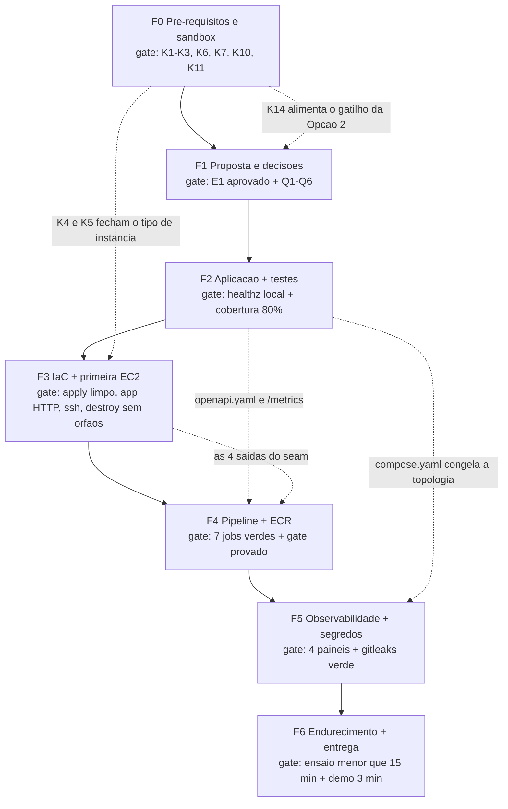

# Plano de Execução — Projeto 2

**Disciplina:** Computação em Nuvem · **UFRPE** — Projeto Integrador: Desenvolvimento e Implantação em Nuvem
**Versão:** 1.0 · **Data:** 2026-11-14
**Fontes:** [`docs/00-edital-projeto-2.md`](00-edital-projeto-2.md) · [`docs/01-analise-requisitos-e-arquitetura.md`](01-analise-requisitos-e-arquitetura.md) · [`docs/02-aws-academy-limites-e-riscos.md`](02-aws-academy-limites-e-riscos.md) · [`docs/03-guia-pre-requisitos.md`](03-guia-pre-requisitos.md) (Fase 0)
**Fora de escopo deste documento:** código, arquivos `.tf`, workflows YAML completos, instalação de ferramentas, matriz de serviços e comparação de arquiteturas (já estão em `docs/00`–`docs/03`).

> **Como usar.** O projeto avança por **gates**: nenhuma fase começa com o gate da anterior vermelho (§8). Cada tarefa foi escrita para ser verificável; se você não consegue dizer como provar que ela terminou, ela não está pronta para começar. Os identificadores usados aqui são os de `docs/01`: **R1–R8** (requisitos), **E1–E5** (entregáveis do §6 do edital) e **C1–C8** (critérios do §7 com pesos).

## 1. Premissas do plano

1. **Arquitetura:** Opção 1 de `docs/01` §5.1 — uma EC2 com Docker Compose, imagem no ECR, `tfstate` e backup no S3, CloudWatch no mínimo e segredos no Infisical Cloud. ALB, RDS e ECS estão fora (§3.4 daquele documento) e voltam apenas como gatilho de revisão (`docs/01` §5.5).
2. **Equipe:** de 1 a 4 integrantes. O esforço em pessoa-dia **não muda** com o tamanho da equipe; o que muda é o tempo de calendário (mais gente = mesma faixa distribuída em menos semanas).
3. **Prazo assumido:** **8 semanas de trabalho efetivo**, o que corresponde a ~1–1,5 pessoa-dia por semana no total da equipe (8 × 1,5 = 12 pd). Se o prazo real for outro, ajuste **apenas a coluna "Semana"** da §5 e leia a §5.1 (compressão para 6 e extensão para 12).
4. **Tema:** A (reservas) ou C (finanças), de `docs/01` §8; o Tema B (help desk) cabe mas acrescenta ~4 pd em F2, o que estoura a faixa de esforço.
5. **Esforço total:** **8,0–12,0 pessoa-dia** (§2), coerente com `docs/01` §4.2(i); a distribuição interna foi rebalanceada e está justificada na nota da §2.
6. **Ambiente:** Windows 11 + WSL2 Ubuntu, Docker Desktop. A instalação de AWS CLI e Terraform é da **F0**, delegada ao `docs/03`; a validação do sandbox é da F0 e é dela.
7. **Fora do plano:** ALB, RDS, ECS/Kubernetes, TLS/domínio próprio, Ansible, alta disponibilidade e testes de carga — decisões já justificadas em `docs/01` §3.4, §5.3 e §6.4.

## 2. Visão geral das fases

| Fase | Objetivo | Entregável do edital | Critérios impactados | Esforço (pd) | Gate de saída (resumo) |
| --- | --- | --- | --- | --- | --- |
| **F0** — Pré-requisitos e sandbox | Provar máquina e conta antes de desenhar qualquer coisa | habilita E2–E5 | C3, C6 | 0,5–1,0 | K1–K3, K6, K7, K10, K11, K14 respondidos e datados em `docs/evidencias/sandbox.md` |
| **F1** — Proposta e decisões | Congelar escopo e arquitetura e obter aprovação | **E1** | C1, C2, C8 | 0,5–1,0 | Proposta aprovada + Q1–Q6 respondidas ou padrão adotado + ADR-0001 escrito |
| **F2** — Aplicação e testes | MVP (domínio, API, UI, migrations) rodando local com testes | **E2**, parte de E4 | **C1 (25%)**, **C5 (10%)** | 4,0–4,5 | `/healthz` local verde, 3 telas operáveis, cobertura do domínio ≥ 80%, teste de concorrência verde |
| **F3** — Infraestrutura como código | Provisionar por Terraform, com estado remoto, e ver a app no ar | **E2**, **E4** | **C3 (15%)**, C1 | 1,5–2,0 | `fmt`/`validate` limpos, `apply` sem erro, app em HTTP, `ssh` OK, `destroy` sem órfãos |
| **F4** — Pipeline CI/CD e ECR | Ciclar sem passo manual, com gate de testes explícito | **E3** | **C4 (15%)**, **C5 (10%)** | 1,0–1,5 | Workflow verde com 7 jobs, imagem com tag = SHA, execução vermelha com `build`/`deploy` `skipped` |
| **F5** — Observabilidade e segredos | Mostrar métrica, log e dashboard vivos; nenhum segredo rastreável | **E2**, **E5** | **C7 (5%)**, **C6 (5%)** | 0,5–1,0 | 4 painéis com dados, log de erro no Loki, `/grafana` protegido, `.env` gerado pelo cofre |
| **F6** — Endurecimento e entrega | Fechar documentação, ensaiar a demo e entregar | **E5**, **E4** | **C8 (5%)** + protege C1–C4 | 0,5–1,0 | Docs completos, ciclo completo em < 15 min, demo de 3 min ensaiada, checklist da §11 marcado |
| **Total** | | | | **8,0–12,0** | — |

> **Por que o total fecha em 8–12 pd (e onde a distribuição difere de `docs/01` §4.2(i)).** A soma das sete fases é **8,0–12,0 pessoa-dia**, exatamente a faixa da Opção 1 em `docs/01` §4.2(i). A distribuição interna, porém, foi rebalanceada: aquele documento reserva **1–3 pd** para "infra + deploy + observabilidade + docs" e **5–7 pd** para a aplicação. Este plano aloca **3,5–5,5 pd** ao bloco de infraestrutura/deploy/observabilidade/docs (F3–F6) e **4,0–4,5 pd** à aplicação com testes (F2), mais **1,0–2,0 pd** para pré-requisitos e proposta (F0–F1). Dois motivos sustentam a troca: (i) 1–3 pd não cobrem Terraform partindo do zero + pipeline de 7 jobs + dashboards versionados + runbook; (ii) `docs/01` §8 orça as **funcionalidades** em 6–8 pd (Tema A: 11–15 pd no total), o que já estouraria a faixa antes de contar infraestrutura. O plano mantém o total dentro da faixa **cortando a aplicação para 4 histórias** em vez das 5 do Tema A. Se o grupo insistir nas 5 histórias *e* na UI polida, o total vai para **12,5–14 pd**, acima da faixa — e a decisão explícita é: cortar a 5ª história, cortar o polimento da UI, ou registrar o estouro no relatório final.

## 3. Fases em detalhe

### F0 — Pré-requisitos e validação do sandbox

**Objetivo.** Provar, em uma única sessão de laboratório, que a máquina e a conta conseguem fazer tudo o que o plano assume — ferramentas, credenciais, key pair, ECR, S3 e os objetos de IAM pré-existentes — antes de desenhar em cima de qualquer suposição.

**Pré-requisitos.** Acesso ao Vocareum do curso (botão **Start Lab**); WSL2 com Ubuntu funcionando; repositório Git do projeto criado no GitHub (pode estar vazio); `docs/03-guia-pre-requisitos.md` disponível. **Se `docs/03` ainda não existir, a instalação é a primeira tarefa desta fase** — o plano referencia o caminho e não duplica o conteúdo.

**Tarefas.**

*Ferramentas (executadas conforme `docs/03`)*
1. Instalar o AWS CLI v2 no WSL e confirmar com `aws --version`.
2. Instalar o Terraform **≥ 1.10** no WSL e confirmar com `terraform version` (a versão decide o lock do estado por `use_lockfile`, `docs/02` §7.3).
3. Confirmar Docker Desktop com `docker compose version` e `docker run --rm hello-world`.
4. Confirmar Node 22 (`node -v`) e `pnpm --version`, que a F2 vai usar (a máquina também tem Python 3.13, que o backend **não** usa mais — ADR-007 em `docs/app/02-arquitetura.md`).
5. Registrar em `docs/evidencias/sandbox.md` a data e a saída de cada verificação de versão.

*Credenciais*
6. Iniciar a sessão no Vocareum (**Start Lab** → **AWS Details** → **AWS CLI: Show**).
7. Exportar as **três** variáveis no WSL e `AWS_DEFAULT_REGION=us-east-1`, conforme `docs/02` §2.2.
8. Rodar `aws sts get-caller-identity` e confirmar que o ARN contém `assumed-role/voclabs/`.
9. Rodar `aws configure get region` e conferir que bate com a região dos recursos.

*Checklist do sandbox (`docs/02` §11)*
10. Executar K1 (`sts`), K2 (região), K3 (key pair: `create-key-pair` **e** `import-key-pair`, depois `delete-key-pair`), K6 (`LabRole`), K7 (`LabInstanceProfile`), K10 (`ecr get-login-password`), K11 (`s3 mb`/`ls`/`rb`) e K14 (`rds describe-db-subnet-groups`).
11. Registrar uma linha por item em `docs/evidencias/sandbox.md` no formato `# | data | comando | resultado | disponível? | o que muda no plano`.
12. Executar K8/K9 com documento de confiança trivial local, **esperando `AccessDenied`**, e anotar "OIDC indisponível — confirmado", fechando o caminho de autenticação do pipeline (`docs/02` §8.1).

*Key pair e higiene*
13. Confirmar o key pair **`vockey`**, o único que a conta do lab tem, e manter a privada (`labsuser.pem`, de *AWS Details*) **fora** de `/mnt/c`, em `~/.ssh/` com `chmod 400` (`docs/02` §10). Não criar `projeto2`: ele não existe na conta e a chave não teria par.
14. Criar o `.gitignore` da raiz com `.env`, `*.tfstate*`, `*.auto.tfvars`, `*.pem`, `.terraform/`, `node_modules/`, `coverage/`.
15. Criar `docs/evidencias/` e revisar `git status --short` para garantir que nada sensível entrou no índice.

**Critérios de aceitação (verificáveis).**

| # | Critério | Como provar |
| --- | --- | --- |
| 1 | Credencial de sessão viva | `aws sts get-caller-identity` → ARN `assumed-role/voclabs/...` |
| 2 | Região coerente | `aws configure get region` e `echo $AWS_DEFAULT_REGION` → `us-east-1` |
| 3 | Terraform atual | `terraform version` → número ≥ 1.10 (senão: backend S3 + DynamoDB, `docs/02` §7.3) |
| 4 | Key pair utilizável | `aws ec2 describe-key-pairs --key-names vockey` → 1 item; `stat -c %a ~/.ssh/labsuser.pem` → `400` |
| 5 | IAM pré-existente lido | `aws iam get-role --role-name LabRole --query Role.Arn` e `aws iam get-instance-profile --instance-profile-name LabInstanceProfile` → valor, não erro |
| 6 | ECR liberado | `aws ecr get-login-password --region us-east-1` → imprime token (nunca cole no log) |
| 7 | S3 liberado | `aws s3 mb s3://bcc-cloud-teste-$RANDOM` e `aws s3 ls` sem erro; bucket removido depois |
| 8 | RDS conhecido | `aws rds describe-db-subnet-groups` → resultado registrado (não bloqueia a Opção 1; alimenta o gatilho de §5.5 de `docs/01`) |
| 9 | Registro completo | `docs/evidencias/sandbox.md` tem ao menos 8 linhas com data, comando e resultado |

**Artefatos.** `docs/evidencias/sandbox.md`; `.gitignore`; `~/.ssh/labsuser.pem` (chave do `vockey`); `~/.aws/credentials` (fora do repositório).

**Riscos da fase.**

| Risco | Mitigação |
| --- | --- |
| Key pair bloqueado (K3 com `AccessDenied`) | Plano B de `docs/02` §10.3: Session Manager ou operação só por `user_data`/HTTP; registrar a troca no runbook |
| Terraform < 1.10 | Backend S3 + tabela DynamoDB para lock (`docs/02` §7.3) |
| Sessão encerrada no meio da checklist | Reemitir as credenciais e retomar do item pendente; a checklist é idempotente |
| Confundir "End Lab" com "recursos apagados" | Reler `docs/02` §6.1–6.2 e escrever isso no runbook |

**Estimativa:** 0,5–1,0 pessoa-dia.
**Não faça ainda.** Não rode `terraform init`/`apply`; não crie o bucket de estado; não escolha o tema definitivo (é a F1). **Ansible é opcional**: `docs/01` §6.4 o descarta da arquitetura e nenhuma fase deste plano depende dele — instalá-lo (`docs/03` §3.5) é só curiosidade, não pré-requisito.

### F1 — Proposta inicial, decisões e aprovação

**Objetivo.** Congelar escopo, funcionalidades e arquitetura e obter a aprovação do professor (E1) **antes** de gastar esforço em código ou infraestrutura.

**Pré-requisitos.** F0 verde (principalmente K3, K6, K7, K10 e K11); tema candidato escolhido provisoriamente entre A/B/C de `docs/01` §8; data da aula de acompanhamento conhecida.

**Tarefas.**

*Conteúdo da proposta (E1)*
1. Escrever em `README.md` §1 as seções **Problema**, **Funcionalidades**, **Arquitetura preliminar** e **Tecnologias selecionadas**, com pelo menos um parágrafo cada (é o conteúdo mínimo exigido pelo §6.1 do edital).
2. Selecionar o tema e congelar **4 histórias** no formato "como X quero Y para Z", mais a regra de negócio não trivial, e listar ao lado o que ficou **fora de escopo**.
3. Transportar para o README o diagrama de componentes de `docs/01` §3.2 e as **cinco saídas** do Terraform (`host_public_ip`, `ecr_registry`, `ecr_repository_urls`, `state_bucket`, `target_port`) — esse é o *seam* que permite trocar de borda sem reescrever o pipeline.
4. Escrever `docs/adr/0001-arquitetura-opcao-1.md` com a decisão, as 5 justificativas de `docs/01` §5.1, os trade-offs aceitos (§5.3), o que ficou fora (§3.4) e os gatilhos de revisão (§5.5).
5. Ligar cada suposição **P1** de `docs/01` §9 à tarefa da F0 que a fechou (A1, A2, A3, A6, A9, A14) e marcar as demais como "a validar em F3".

*Decisões com o professor*
6. Levar as 6 decisões de `docs/01` §10 para a aula e anotar a resposta de cada uma, ou "sem resposta → adoto o padrão declarado".
7. Registrar data, respostas e a conclusão da conversa em `docs/evidencias/f1-aprovacao.md`, destacando a **Q2** (integração de serviços AWS), que é a pergunta de maior consequência.
8. Confirmar formato, data e duração da entrega e da apresentação, e quem opera a demo.

*Repositório*
9. Criar a estrutura de pastas `app/`, `infra/`, `.github/workflows/`, `tests/`, `observability/`, `docs/evidencias/` com `.gitkeep` onde necessário.
10. Escrever a seção **Equipe e divisão de tarefas** no README (exigência R5.2 de `docs/01` §2.4).
11. Fazer o primeiro commit e definir o fluxo de branches (trunk-based com PRs, ou `develop` + PRs) — o histórico é evidência de C3/C4.
12. Registrar no runbook que a proteção do branch padrão será ligada na F4, quando os checks existirem.

**Critérios de aceitação (verificáveis).**

| # | Critério | Como provar |
| --- | --- | --- |
| 1 | E1 com os 4 itens do edital | `README.md` contém as 4 seções, cada uma com ≥ 1 parágrafo |
| 2 | Escopo congelado e datado | 4 histórias + regra não trivial + "fora de escopo" no README, com data |
| 3 | Decisão registrada | `docs/adr/0001-arquitetura-opcao-1.md` tem as 5 justificativas e os gatilhos de revisão |
| 4 | Perguntas cobertas | `docs/evidencias/f1-aprovacao.md` lista Q1–Q6 com resposta ou "padrão adotado em <data>" |
| 5 | Aprovação registrada | mesmo arquivo com data da aula e "aprovado / aprovado com ressalvas / revisar X" |
| 6 | Repositório íntegro | `git log --oneline` ≥ 2 commits; `git status` limpo; `.gitignore` da F0 intacto |

**Artefatos.** `README.md` (§1–§5); `docs/adr/0001-arquitetura-opcao-1.md`; `docs/evidencias/f1-aprovacao.md`; estrutura de pastas.

**Riscos da fase.**

| Risco | Mitigação |
| --- | --- |
| Professor exige serviço gerenciado de banco/balanceador | Gatilho 1 de `docs/01` §5.5: Opção 2 **apenas na janela da demo**, com `destroy` no dia seguinte; o *seam* evita reescrever o pipeline |
| Professor não responde às 6 perguntas | Seguir os padrões declarados e registrar "padrão adotado em <data>" — nunca congelar o projeto esperando resposta |
| Escopo inflando durante a conversa | Regra do "entra uma, sai uma": toda história nova remove outra do MVP |
| Proposta aprovada por oralidade e depois contestada | Registrar em `f1-aprovacao.md` a data, o formato e as palavras-chave da resposta |

**Estimativa:** 0,5–1,0 pessoa-dia.
**Não faça ainda.** Não implemente funcionalidades; não crie arquivos em `infra/`; não configure CI; não crie o projeto no Infisical.

### F2 — Aplicação: domínio, API, UI e testes

**Objetivo.** Entregar o MVP funcional (domínio, API, persistência e UI) rodando no Docker Compose local, com testes unitários, de integração e de contrato que provam a regra de negócio.

**Pré-requisitos.** F1 aprovada e escopo congelado; Docker Desktop funcionando; contrato de API esboçado; nenhuma credencial AWS necessária nesta fase.

**Tarefas.**

*Contrato e domínio*
1. Escrever `openapi.yaml` com os 6–8 endpoints do MVP, os códigos de erro e os schemas — é o contrato UI↔API de `docs/01` §3.3.
2. Criar o esqueleto da API em `app/api/` (**NestJS + TypeScript**; no monorepo entregue, `backend/`) com `package.json` (pnpm) fixando `eslint`, `tsc --noEmit`, `jest` e cobertura.
3. Modelar as entidades do tema (ex.: `usuario`, `recurso`, `reserva`) no schema Prisma (`app/api/prisma/schema.prisma`), com chaves estrangeiras e *constraints*.
4. Escrever a migration inicial com Prisma (`prisma migrate dev --name init`, em `app/api/prisma/migrations/`) e aplicá-la em um Postgres local.
5. Escrever o teste que **viola** a regra não trivial (ex.: duas reservas sobrepostas) e só depois implementar o serviço transacional em `app/api/src/`.
6. Implementar os endpoints do contrato com validação `class-validator`/`class-transformer` (`ValidationPipe`) e erros em JSON padronizado.
7. Implementar autenticação mínima (cadastro, login, senha com hash, token) reutilizando a camada de configuração que a F5 vai alimentar com segredos.
8. Implementar `/healthz` (liveness), `/readyz` (verifica o banco) e `/metrics` (contadores por rota/status e histograma de latência).

*UI*
9. Criar a SPA em `app/web/` (Vite + React + TypeScript; no monorepo entregue, `frontend/`) com build estático servível por Nginx.
10. Implementar as 3 telas do MVP — listar/filtrar, criar/editar e "minhas reservas" — com estados de carregamento, erro e vazio em todas.
11. Consumir a API pelo contrato, com base path relativo `/api`, sem URL absoluta no código.
12. Escrever `app/web/nginx.conf` com *fallback* da SPA, proxy para `/api` e o bloco `/grafana` reservado para a F5.

*Testes e empacotamento*
13. Escrever os testes unitários em `tests/unit/` (regra de conflito, validação, serializers), com relógio injetado e tudo em UTC.
14. Escrever o teste de integração em `tests/integration/` que prova a invariante sob concorrência (duas requisições simultâneas, uma deve receber conflito) e o fluxo criação→listagem→filtro.
15. Escrever o teste de contrato em `tests/api/` (Supertest) validando status e schema contra `openapi.yaml`.
16. Escrever os `Dockerfile` multi-stage de `api` e `web` (`USER` não-root, `.dockerignore`) e o `compose.yaml` com os profiles `dev`/`prod` e `healthcheck` em todos os serviços.
17. Rodar `docker compose --profile dev up -d --build` e validar o fluxo completo no navegador local.

**Critérios de aceitação (verificáveis).**

| # | Critério | Como provar |
| --- | --- | --- |
| 1 | Regra de negócio provada | `pnpm test` verde; cobertura do domínio (`app/api/src`) ≥ 80% |
| 2 | Integração com banco real | `pnpm exec jest tests/integration` verde contra o Postgres do compose |
| 3 | Contrato respeitado | `pnpm exec jest tests/api` verde e `openapi.yaml` idêntico ao gerado (`pnpm openapi:generate` + `git diff --exit-code`) |
| 4 | App local funcionando | `curl -fsS localhost:8080/healthz` e `/readyz` → 200; `/metrics` contém `http_requests_total` |
| 5 | Persistência real | criar um registro na UI, `docker compose restart api`, recarregar e o registro continua lá |
| 6 | Compose válido | `docker compose config -q` → exit 0 |
| 7 | UI operável por leigo | 3 telas navegáveis, console sem erro e mensagem clara ao enviar formulário inválido |

**Artefatos.** `app/api/`, `app/web/`, `tests/unit/`, `tests/integration/`, `tests/api/`, `openapi.yaml`, `compose.yaml`, `app/api/Dockerfile`, `app/web/Dockerfile`, `app/web/nginx.conf`.

**Riscos da fase.**

| Risco | Mitigação |
| --- | --- |
| A UI consumir o prazo (risco R06 da §9) | *Timebox* de 1 pd para a UI e checklist de 3 telas; se estourar, corta filtro avançado e tema visual |
| Regra de negócio ambígua ou não testável | Escrever o teste de concorrência **antes** do serviço (tarefa 5); se não houver invariante testável, trocar de tema na F1 |
| Postgres local preso a porta ocupada | Portas altas (5433), `env_file` por profile e `docker compose down -v` documentado |
| Teste *flaky* por fuso horário | `TZ=UTC`, relógio injetado e proibição de `sleep` fixo nos testes |

**Estimativa:** 4,0–4,5 pessoa-dia.
**Não faça ainda.** Não crie `infra/`; não publique imagem no ECR; não suba Prometheus/Grafana/Loki (é a F5); não implemente anexos em S3 ou relatórios fora das 4 histórias; não escreva workflows (é a F4).

### F3 — Infraestrutura como código: Terraform, backend S3 e primeira EC2

**Objetivo.** Transformar "roda na minha máquina" em "criado por Terraform, com estado remoto, app respondendo no IP público e destruível sem órfãos".

**Pré-requisitos.** F2 verde (`compose config -q` e `/healthz` local); F0 verde (key pair, ECR, S3 e `LabInstanceProfile` confirmados); credenciais de sessão com pelo menos 2 h restantes; bucket de estado já criado pelo procedimento de *bootstrap*.

**Tarefas.**

*Base do Terraform*
1. Criar `infra/versions.tf` com `required_version` ≥ 1.10, provider AWS fixado e `region = "us-east-1"`.
2. Criar `infra/backend.tf` com backend S3 (`bucket`, `key`, `encrypt = true`, `use_lockfile = true`).
3. Escrever no runbook o comando de *bootstrap* do bucket de estado, explicitando que ele **não** pertence ao state que o usa (`docs/02` §7.3).
4. Criar `infra/variables.tf` com `project_name`, `instance_type` (`t3.small`), `key_name`, `instance_profile_name` (default `LabInstanceProfile`), `allowed_ssh_cidrs` e `data_volume_gb`.
5. Criar `infra/data.tf` lendo `data "aws_iam_instance_profile" "lab"`, `data "aws_iam_role" "lab"` e a AMI Ubuntu mais recente — **nenhum** recurso `aws_iam_*` no código.
6. Criar `infra/keypair.tf` com `data "aws_key_pair"` referenciando o key pair da F0.
7. Criar `infra/network.tf` com security group liberando 80 e restringindo 22 ao CIDR parametrizado (se abrir para o mundo, justificar por escrito).

*Compute, dados e artefatos*
8. Criar `infra/compute.tf` com `aws_instance` `t3.small`, `iam_instance_profile` vindo do `data`, `user_data` que instala Docker/Compose, cria `/opt/app` e habilita o serviço `systemd` de `compose up`.
9. Criar `infra/storage.tf` com volume EBS `gp3` de dados, formatado e montado de forma idempotente no `user_data`.
10. Criar `infra/ecr.tf` com repositório, `image_scanning_configuration` e *lifecycle policy* de 5 imagens.
11. Criar `infra/outputs.tf` com **exatamente** as cinco saídas do *seam*: `host_public_ip`, `ecr_registry`, `ecr_repository_urls`, `state_bucket`, `target_port`.
12. Criar `infra/terraform.tfvars.example` sem valores sensíveis e conferir `git status` (nenhum `.tfstate`, nenhum `.pem`).

*Primeiro ciclo completo*
13. Rodar `terraform fmt -check -recursive` e `terraform validate`.
14. Rodar `terraform init` e `terraform plan -out=plan.out`, lendo o plano linha a linha: contar recursos, conferir ausência de `aws_iam_*` e de destruição inesperada.
15. Rodar `terraform apply plan.out` **sem** `-auto-approve`, cronometrando (meta < 10 min, `docs/02` §12).
16. Construir as imagens de `api` e `web` com tag = SHA do commit, autenticar no ECR e publicar.
17. Conectar por `ssh -i ~/.ssh/labsuser.pem ubuntu@<host_public_ip>`, criar `/opt/app/.env` com `chmod 600`, rodar `docker compose --profile prod pull` e `docker compose --profile prod up -d --no-build`, e por fim `docker compose exec -T api npm run --silent prisma:deploy`.
18. Rodar o smoke manual: `curl -fsS http://<host_public_ip>/healthz`, `/readyz`, criar e listar um registro pela UI.
19. Escrever `docs/runbook-operacao.md` com os quatro procedimentos: subir, implantar, destruir, encerrar sessão.
20. Rodar `terraform destroy` como teste controlado e conferir a ausência de órfãos.

**Critérios de aceitação — gate da F3 (verificáveis).**

| # | Critério | Como provar |
| --- | --- | --- |
| 1 | Código formatado e válido | `terraform fmt -check -recursive` = 0 e `terraform validate` = "Success! The configuration is valid." |
| 2 | `apply` limpo a partir de diretório limpo | log de `terraform apply` sem erro, anexado em `docs/evidencias/f3-apply.txt` |
| 3 | Idempotência | segundo `terraform plan` → "No changes." |
| 4 | Estado remoto de fato | `aws s3 ls --recursive s3://<state_bucket>` lista `terraform.tfstate` sob o prefixo de `key` em `infra/backend.tf`; `terraform state list \| wc -l` ≥ 8 |
| 5 | Nenhum IAM criado | `grep -rn 'resource "aws_iam' infra/` → vazio; `terraform state list \| grep aws_iam` → vazio |
| 6 | App acessível | `curl -fsS http://<host_public_ip>/healthz` → 200 e a home da SPA carrega no navegador |
| 7 | `ssh` funcionando | `ssh -i ~/.ssh/labsuser.pem -o BatchMode=yes ubuntu@<host_public_ip> 'cd /opt/app && docker compose -f compose.yaml -f infra/deploy/compose.prod.yaml --profile prod ps'` → `api` e `web` `running (healthy)` |
| 8 | Persistência no EBS | `stop`/`start` da instância e os dados continuam após o `compose up` |
| 9 | `destroy` sem órfãos | depois de `terraform destroy` (exit 0): `aws ec2 describe-instances --filters "Name=tag:project,Values=<projeto>"` sem `running`/`stopped`; `aws ec2 describe-volumes` sem volume com a tag; `terraform plan` → "No changes" com state vazio |
| 10 | Bucket de estado preservado | o bucket de *bootstrap* continua existindo depois do `destroy` (não pertence a este state) |
| 11 | Runbook escrito | `docs/runbook-operacao.md` tem os quatro procedimentos com comandos copiáveis |

**Artefatos.** `infra/*.tf`; `docs/runbook-operacao.md`; `docs/evidencias/f3-plan.txt`, `f3-apply.txt`, `f3-destroy.txt`, `f3-url.png`.

**Riscos da fase.**

| Risco | Mitigação |
| --- | --- |
| Sessão expira no meio do `apply` (R01 §9) | Protocolo de `docs/02` §2.6: não apagar nada, renovar, `plan`, `import`/`state rm`, reaplicar; `apply` sempre no início da sessão |
| `t3.small` negado ou sem oferta (K4) | Trocar `instance_type` pela variável; se descer para `t3.micro`, adiar a F5 ou limitar `mem_limit`/retenção |
| `user_data` falha em silêncio | O smoke da tarefa 18 denuncia na hora; diagnóstico em `/var/log/cloud-init-output.log` |
| `destroy` deixa recurso órfão | Repetir `destroy` até `plan` limpo; tag `project` em tudo para localizar órfãos |
| Host "pet" (ajuste manual some) | Regra: todo ajuste vira `user_data` ou compose versionado; nunca editar `/opt/app` sem commitar |

**Estimativa:** 1,5–2,0 pessoa-dia.
**Não faça ainda.** Não crie ALB nem RDS; não suba a stack de observabilidade (F5); não escreva o workflow (F4); não use `-auto-approve`; não coloque IP em variável ou arquivo versionado.

### F4 — Pipeline CI/CD completo e publicação no ECR

**Objetivo.** Repetir a F3 sem passo manual: push/PR → lint, testes, build, push no ECR, deploy e smoke, com o *gate* de testes explícito no grafo de jobs.

**Pré-requisitos.** F3 verde; repositório no GitHub com Actions habilitado; `AWS_ACCESS_KEY_ID`, `AWS_SECRET_ACCESS_KEY`, `AWS_SESSION_TOKEN` e a chave privada SSH gravados como Actions Secrets; imagem já publicada manualmente na F3.

**Tarefas.**

*CI (sem AWS)*
1. Criar `.github/workflows/ci.yml` com os jobs `lint` (eslint + `tsc --noEmit`), `test-unit`, `test-integration` (service container `postgres:16` com `healthcheck`) e `test-api`.
2. Publicar como artefatos apenas o JUnit XML e o relatório de cobertura, com caminhos explícitos — nunca `tfstate`, `.env` ou `docker save` (`docs/01` §7.5).
3. Adicionar o job `secrets` (`gitleaks`) reprovando o PR ao encontrar segredo no diff.

*CD (com AWS)*
4. Criar `.github/workflows/deploy.yml` com `workflow_dispatch`, `concurrency` para impedir dois deploys simultâneos e `permissions: contents: read`.
5. Implementar o job `preflight` com `aws sts get-caller-identity` e mensagem explícita ("renove a sessão do lab"), executando **antes** de qualquer job com AWS.
6. Implementar o job `build` com `docker buildx` e push para o ECR com tag = SHA do commit, sem `latest`.
7. Implementar o job `tf-plan` (somente em PR) rodando `fmt -check`, `validate` e `plan -no-color`, com a saída no *summary*.
8. Implementar o job `deploy`: `terraform apply` quando `infra/` mudou; depois SSH → `compose pull && up -d --no-build` e `docker compose exec -T api npm run --silent prisma:deploy`, lendo **apenas** `terraform output -json`.
9. Implementar o job `smoke` que descobre a URL pelas saídas e verifica `/healthz`, `/readyz`, e criação+leitura de um registro pelo contrato, **falhando o workflow** em qualquer desvio.
10. Publicar no `$GITHUB_STEP_SUMMARY` a URL, o digest da imagem e o SHA implantado.
11. Configurar a proteção do branch padrão exigindo `lint`, `test-unit`, `test-integration` e `secrets` verdes.

*Prova do gate*
12. Rodar a cadeia duas vezes: uma completa (verde) e uma com um teste quebrado de propósito (commit temporário, revertido em seguida), capturando as duas telas.
13. Registrar em `docs/evidencias/f4-gate.md` qual job falhou e quais ficaram `skipped` na execução vermelha — é a evidência exigida por R3.5.3.

**Critérios de aceitação (verificáveis).**

| # | Critério | Como provar |
| --- | --- | --- |
| 1 | Pipeline mínimo do edital | execução verde com `preflight, lint, test-unit, test-integration, build, deploy, smoke` — as 4 etapas do §3.3 do edital visíveis no histórico |
| 2 | Gate provado | na execução vermelha, `build` e `deploy` aparecem `skipped` |
| 3 | Artefato por SHA | `aws ecr describe-images --repository-name <repo> --query 'imageDetails[].imageTags'` contém o SHA implantado |
| 4 | Sem IP no repositório | `grep -rnE '([0-9]{1,3}\.){3}[0-9]{1,3}' .github/ infra/ \| grep -v '0\.0\.0\.0'` → vazio |
| 5 | Deploy sem clique humano após o dispatch | log do job `deploy` mostra `apply`, `compose pull`, `up -d` e `prisma migrate deploy` |
| 6 | Smoke honesto | derrubar o banco no host e ver `smoke` (não `deploy`) reprovar o workflow |
| 7 | Segredo fora do Git | `gitleaks` verde; `git log --all --full-history -- "*.env"` → vazio |
| 8 | Credenciais mascaradas | log do workflow exibe `***` no lugar dos valores; busca pelo prefixo do segredo no log não retorna nada |

**Artefatos.** `.github/workflows/ci.yml`; `.github/workflows/deploy.yml`; `docs/evidencias/f4-pipeline-verde.png`, `f4-pipeline-vermelho.png`, `f4-gate.md`; JUnit XML e cobertura como artefatos do workflow.

**Riscos da fase.**

| Risco | Mitigação |
| --- | --- |
| Token de sessão vence entre dispatch e deploy | `preflight` com mensagem clara; rodar o deploy cedo na sessão; atualizar os 3 secrets no início (§10) |
| SSH dos runners bloqueado | Plano B *pull-based* (timer no host puxando do ECR via instance profile, `docs/01` §4.2h-4) |
| CI lento demais | Cache de build, Dockerfile multi-stage e um único service container de Postgres |
| `test-integration` *flaky* | `healthcheck` do Postgres antes dos testes, `retry` limitado e proibição de `sleep` |
| `Error acquiring the state lock` | `terraform force-unlock <id>` só depois de confirmar que ninguém está aplicando (`docs/02` §7.4) |

**Estimativa:** 1,0–1,5 pessoa-dia.
**Não faça ainda.** Não tente OIDC (`docs/02` §8.1); não use `pull_request_target` com secrets; não configure dashboards (F5); não dispare deploy em PR de fork.

### F5 — Observabilidade e gerenciamento de segredos

**Objetivo.** Entregar C7 e C6 funcionando no ar: métricas, logs e dashboard com dados reais, e nenhum segredo rastreável em repositório, log, imagem ou host.

**Pré-requisitos.** F3 verde (host provisionado); F4 verde (o `deploy` sabe regenerar o `.env`); `/metrics` exposto desde a F2; identidade de máquina criada no Infisical.

**Tarefas.**

*Coleta e visualização*
1. Criar `observability/compose.obs.yaml` (profile `obs`) com Prometheus, Loki, Promtail, Grafana, Telegraf, cAdvisor e node-exporter, com `mem_limit` e retenção de 7 dias.
2. Criar `observability/prometheus/prometheus.yml` com *scrape* de 15 s no `/metrics`, no Telegraf, no cAdvisor e no node-exporter.
3. Criar `observability/promtail/promtail-config.yml` lendo os logs dos containers e extraindo apenas rótulos de baixa cardinalidade (`service`, `level`, `route`) — nunca entrada de usuário.
4. Ajustar a API para escrever log JSON com `level`, `request_id`, `route`, `status` e `latency_ms`, com redação de `authorization`, `cookie` e `set-cookie`.
5. Montar as 4 consultas do dashboard: RED (req/s, p95, 5xx), host (CPU/memória/disco/reinícios), disponibilidade sintética (`healthz`/`readyz` via Telegraf) e logs `level=error`.
6. Criar `observability/grafana/provisioning/` e `observability/grafana/dashboards/main.json` versionado, com anotação de deploy por SHA.
7. Proteger `/grafana` no Nginx (basic auth ou login do Grafana) com senha vinda do cofre.

*Segredos*
8. Criar o projeto/ambiente `prod` no Infisical e cadastrar `DB_PASSWORD`, `JWT_SECRET` e `GRAFANA_PASSWORD`.
9. Criar a identidade de máquina com escopo mínimo e gravar o token como `INFISICAL_TOKEN` nos Actions Secrets.
10. Ajustar o job `deploy` para gerar `/opt/app/.env` com `infisical export`, `chmod 600`, aplicando `::add-mask::` em cada valor antes de usá-lo.
11. Substituir valores fixos por variáveis de ambiente no `compose.yaml` e remover qualquer senha do `user_data`.
12. Rodar `gitleaks detect --no-git` na imagem construída e no repositório, corrigindo todos os achados.

**Critérios de aceitação (verificáveis).**

| # | Critério | Como provar |
| --- | --- | --- |
| 1 | Métricas coletadas | `curl -s localhost:9090/api/v1/targets` sem alvo `down`; aba *Targets* com todos `UP` |
| 2 | Métricas exigidas pelo edital | `curl -s 'localhost:9090/api/v1/query?query=rate(http_requests_total[5m])'` retorna série não vazia; p95 e 5xx aparecem |
| 3 | Logs correlacionados | LogQL `{service="api"} \|= "error"` devolve linhas com `request_id`; provocar um erro e achar seu log no painel |
| 4 | Dashboard versionado e vivo | `observability/grafana/dashboards/main.json` tem 4 painéis; URL aberta mostra dados dos últimos 15 min e print datado |
| 5 | `/grafana` protegido | `curl -s -o /dev/null -w "%{http_code}" http://<host>/grafana/` → 401 ou 302 sem credencial |
| 6 | Segredo só no cofre | `git ls-files \| xargs grep -l '<valor real>'` → vazio; `gitleaks` verde; `docker history` da imagem sem `ENV`/`ARG` de segredo |
| 7 | App boota com segredo do cofre | remover o `.env` local, rodar o `deploy` e ver `/readyz` verde (o valor veio do Infisical) |
| 8 | Sem segredo em log | log do job `deploy` mostra `***` no lugar dos valores |
| 9 | Disco sob controle | `docker stats --no-stream` todos abaixo do `mem_limit`; `df -h` do volume de dados < 80% |

**Artefatos.** `observability/**`; `docs/seguranca.md` (modelo de segredos, rotação e escopo do token); `docs/evidencias/f5-dashboard.png`, `f5-targets.png`, `f5-log-erro.png`.

**Riscos da fase.**

| Risco | Mitigação |
| --- | --- |
| OOM com a stack inteira em uma instância pequena | `mem_limit` por serviço, retenção de 7 dias e Grafana sem plugins extras |
| Loki com volume ou cardinalidade alta | Rótulos de baixa cardinalidade, `batch_wait` e retenção curta |
| Infisical Cloud indisponível na demo | `.env` em cache no host com `chmod 600` e validade declarada no runbook |
| Senha aparecendo em print de tela | Usar valores descartáveis e raspar antes de publicar imagens em `docs/evidencias/` |
| `/grafana` exposto | Rodar o critério 5 **antes** de mostrar o dashboard a alguém |

**Estimativa:** 0,5–1,0 pessoa-dia.
**Não faça ainda.** Não migre a coleta para CloudWatch como fonte principal (CloudWatch fica como opcional); não configure Alertmanager nem e-mail (sem SES); não altere `infra/` além do necessário (o Grafana entra pela mesma porta 80).

### F6 — Endurecimento, documentação, ensaio e entrega

**Objetivo.** Fechar a documentação, endurecer a operação e ensaiar a demonstração até que a entrega seja reprodutível por alguém que não participou do desenvolvimento.

**Pré-requisitos.** F2–F5 verdes; data e formato da apresentação conhecidos; crédito restante para um ensaio completo.

**Tarefas.**

*Documentação (E5)*
1. Escrever o `README.md` final: problema, arquitetura com diagrama, tecnologias e justificativas, como rodar, como implantar, como destruir e divisão de tarefas.
2. Revisar `docs/runbook-operacao.md` com os quatro procedimentos, o protocolo de credencial expirada (`docs/02` §2.6) e o de lock preso (§7.4).
3. Escrever `docs/seguranca.md` com modelo de segredos, riscos aceitos (`LabRole` larga, HTTP sem TLS, SSH exposto) e a justificativa honesta de "least privilege possível" (`docs/02` §4.3-5).
4. Escrever `docs/observabilidade.md` explicando onde ver cada métrica, log e painel e o que cada um prova.
5. Escrever no README a seção "Como os testes bloqueiam o deploy", com a tabela de `docs/01` §6.3 e o link para a execução vermelha da F4.

*Endurecimento*
6. Revisar o security group: 22 restrito ou justificado, 80 aberto e nenhuma outra porta exposta.
7. Conferir `chmod 600` do `/opt/app/.env` e do `.pem` fora de `/mnt/c`; registrar a decisão sobre `fail2ban`/`ufw`.
8. Rodar a varredura final: `gitleaks detect`, `terraform fmt -check -recursive` e `git log --all --full-history -- "*.env"` vazio.

*Ensaio*
9. Rodar o ciclo completo do zero em ensaio cronometrado — `destroy` → `apply` → `deploy` → `smoke` → dashboard — com meta total < 15 min.
10. Ensaiar o roteiro de 3 minutos de `docs/01` §7.6 (criar dois registros, filtrar, provocar erro, mostrar 5xx, mostrar log, mostrar o workflow) e gravar uma versão de segurança em vídeo.
11. Registrar em `docs/evidencias/f6-ensaio.md` os tempos de cada etapa e o que falhou.

**Critérios de aceitação (verificáveis).**

| # | Critério | Como provar |
| --- | --- | --- |
| 1 | Documentação mínima (R3.7) | `README.md`, `docs/runbook-operacao.md`, `docs/seguranca.md` e `docs/observabilidade.md` existem e trazem comandos copiáveis |
| 2 | Remoção documentada (R3.7.2) | runbook tem "destruir" com `terraform destroy` **e** a verificação de órfãos |
| 3 | Divisão de tarefas (R5.2) | seção "Equipe e divisão" no README com nomes e fases |
| 4 | Ciclo reproduzível | ensaio com `destroy`+`apply`+`deploy`+`smoke` verdes em < 15 min, logs em `f6-ensaio.md` |
| 5 | Demo ensaiada | roteiro de `docs/01` §7.6 executado em ≤ 3 min, com vídeo de fallback gravado |
| 6 | Zero segredo | `gitleaks detect` verde no repositório e na imagem |
| 7 | Repositório educado | `terraform fmt -check -recursive` = 0; `git status` limpo; `git count-objects -vH` < 50 MB |

**Artefatos.** `README.md` final; `docs/runbook-operacao.md`; `docs/seguranca.md`; `docs/observabilidade.md`; `docs/evidencias/f6-ensaio.md`; vídeo/print da demo.

**Riscos da fase.**

| Risco | Mitigação |
| --- | --- |
| O ensaio consumir crédito | Um ensaio completo e o restante em modo `plan`; `destroy` imediatamente depois |
| Documentação descrevendo arquitetura que mudou | Revisar citando nomes de arquivo reais (`grep` pelos caminhos no README) |
| Demo dependendo de um único notebook | Vídeo gravado + URL alternativa combinada com o professor |
| Crédito acabando na véspera | Recriar a infraestrutura 1 h antes da apresentação, não no dia anterior |

**Estimativa:** 0,5–1,0 pessoa-dia.
**Não faça ainda.** Não invente funcionalidade nova; não troque a arquitetura na véspera; não suba RDS/ALB fora do combinado com o professor.

## 4. Dependências entre fases

Cada fase só começa quando o gate da anterior está verde. As setas pontilhadas indicam informação que atravessa fases (não autorizam começar, mas evitam retrabalho).

**Atividades paralelizáveis em grupo de 2 a 4 pessoas.**

| Frente | Dono | Pode trabalhar em | Enquanto | Sem conflito porque |
| --- | --- | --- | --- | --- |
| Aplicação | integrante A | `app/api/`, `tests/` | F2 | é o único que escreve em `app/api/` |
| Interface | integrante B | `app/web/` | F2, depois de `openapi.yaml` congelado | só consome o contrato; não edita a API |
| Infraestrutura | integrante C | `infra/` | F3, depois de `compose.yaml` existir | `infra/` é exclusivo; contrato é a topologia do compose |
| Pipeline | integrante D | `.github/` | F4, depois de `infra/outputs.tf` existir | ninguém mais em `.github/`; contrato são as 5 saídas |
| Observabilidade | A ou B | `observability/` | F5 (em local antes do host) | pasta separada e dashboard em arquivo versionado |
| Documentação | C ou D | `docs/`, `README.md` | de F1 a F6 | quem escreve em `docs/` não mexe em `app/` nem `infra/` |

Regras de convivência, em ordem de importância:
1. **Contrato primeiro:** `openapi.yaml` e `compose.yaml` são compartilhados — só mudam por PR revisado por quem consome.
2. **Uma pessoa por pasta:** ninguém edita `app/api/` e `app/web/` no mesmo dia sem avisar.
3. **`infra/` nunca em par:** só quem tem o gate da F3 aplica Terraform; um segundo `apply` simultâneo esbarra no lock de estado.
4. **Grupo de 4:** quem não tem frequência de lab (R04 §9) não é dono de tarefa de `apply`; fica com UI, testes, dashboards e docs.
5. **Compressão:** para 6 semanas, as arestas F3→F4→F5 podem virar F3→(F4 ∥ F5), desde que o dono do dashboard trabalhe **só** em `observability/`.

## 5. Cronograma em 8 semanas

| Semana | Fases ativas | Marco verificável ao fim da semana | Evidência a guardar |
| --- | --- | --- | --- |
| 1 | F0 | Sandbox validado: credenciais, key pair, ECR, S3, `LabRole`/`LabInstanceProfile` respondidos | `docs/evidencias/sandbox.md` + saída de `terraform version` |
| 2 | F1 | Proposta aprovada (E1) com escopo congelado e ADR-0001 | ADR-0001 + `f1-aprovacao.md` + slide da aula |
| 3 | F2 (domínio + API) | API rodando local: migrations aplicadas, `/healthz` e `/readyz` 200, `pnpm test` verde | log do jest + `openapi.yaml` + `f2-curl.txt` |
| 4 | F2 (UI + testes) | 3 telas operáveis e invariante provada sob concorrência | print da UI + `f2-cobertura.txt` + resultado do teste de integração |
| 5 | F3 | `terraform apply` cria a EC2 e a app responde em HTTP; `destroy` sem órfãos | `f3-plan.txt`, `f3-apply.txt`, `f3-destroy.txt`, print da URL |
| 6 | F4 | Workflow verde com 7 jobs e imagem no ECR com tag = SHA; gate provado em execução vermelha | `f4-pipeline-verde.png`, `f4-pipeline-vermelho.png`, `f4-gate.md` |
| 7 | F5 | Dashboard com 4 painéis e `.env` vindo do Infisical; `gitleaks` verde | `f5-dashboard.png`, `f5-targets.png`, `f5-log-erro.png` |
| 8 | F6 | Ciclo completo em < 15 min, docs completos e demo de 3 min ensaiada | `f6-ensaio.md` + vídeo da demo + checklist da §11 marcado |

### 5.1 Como comprimir para 6 semanas e como esticar para 12

**Comprimir para 6 semanas:**
1. Faça F0 e F1 na mesma semana — a checklist do sandbox vira argumento da própria proposta.
2. Em F2, congele `openapi.yaml` no primeiro dia e rode **API (A) ∥ UI (B)** em paralelo em vez de sequencial.
3. Comece F3 assim que `compose.yaml` e os `Dockerfile` existirem, mesmo com uma imagem "hello"; a app real entra no deploy depois do `apply`.
4. Rode **F4 ∥ F5** em duas frentes, com o dono do dashboard validando em `docker compose --profile obs` local antes de ir ao host.
5. Corte escopo declarado: 3 histórias em vez de 4, **um** teste de integração e 3 painéis em vez de 4.
6. Ordem de corte se ainda faltar tempo: 4º painel → filtro da UI → teste de contrato (preservando unitários + integração, que valem C5).

**Esticar para 12 semanas:** o esforço **mínimo** não muda (8 pd); o que entra é folga e upgrade opcional.
1. Semanas 9–10: a 5ª história do Tema A, Playwright E2E e `pg_dump` para S3 com restauração testada (vale C1 e C3).
2. Semana 11: janela da Opção 2 **apenas na demo**, se a Q2 exigir (`docs/01` §5.5-1), com `destroy` no dia seguinte.
3. Semana 12: buffer, segundo ensaio cronometrado e congelamento de escopo 72 h antes da apresentação.
4. Esses upgrades somam **+2 a +4 pd**: se forem aceitos, o total vai para 10–14 pd — acima da faixa de `docs/01` §4.2(i) e, por isso, decisão explícita e registrada, não descuido.

## 6. Marcos com evidência

| Marco | Semana | O que se pode mostrar | Arquivo de evidência |
| --- | --- | --- | --- |
| **M0** Sandbox validado | 1 | `aws sts get-caller-identity` retornando `LabRole`, key pair criado, ECR e S3 respondendo, tabela K preenchida | `docs/evidencias/sandbox.md` |
| **M1** Proposta aprovada | 2 | E1 completo: problema, 4 funcionalidades, arquitetura preliminar, tecnologias, ADR com as 5 justificativas | `f1-aprovacao.md` + `docs/adr/0001-*.md` |
| **M2** MVP local testado | 4 | 3 telas operáveis, `pnpm test` verde com cobertura, teste de concorrência provando a invariante | `f2-cobertura.txt` + print da UI |
| **M3** Primeira nuvem | 5 | "`terraform apply` cria a EC2 e a app responde em HTTP" + `ssh` + `destroy` sem órfãos | `f3-apply.txt`, `f3-destroy.txt`, `f3-url.png` |
| **M4** Pipeline completo | 6 | "Workflow verde com 7 jobs", imagem no ECR com tag = SHA, e a execução vermelha mostrando `build`/`deploy` `skipped` | `f4-pipeline-verde.png`, `f4-pipeline-vermelho.png` |
| **M5** Observabilidade e segredos | 7 | "Dashboard com 4 painéis", erro provocado aparecendo no Loki, `.env` gerado pelo Infisical, `gitleaks` verde | `f5-dashboard.png`, `f5-log-erro.png`, `f5-targets.png` |
| **M6** Entrega | 8 | Ciclo completo `destroy`→`apply`→`deploy`→`smoke` em < 15 min, demo de 3 min ensaiada, docs completos | `f6-ensaio.md` + vídeo + checklist da §11 |

## 7. Mapa de rastreabilidade entrega → nota

| Critério (peso) | Onde é produzido | Evidência concreta que comprova | Risco de perder pontos se… |
| --- | --- | --- | --- |
| **C1** Desenvolvimento da aplicação (**25%**) | F2 (e F6) | URL viva + 3 telas + regra de negócio testada + README com casos de uso | a UI só funcionar com dados pré-carregados que o `apply` não cria; ou a demo precisar de explicação para operar |
| **C2** Serviços AWS integrados (**20%**) | F3, F4, F5 | EC2 criada por Terraform + imagem puxada do ECR + `tfstate`/backup no S3 + observabilidade + ADR justificando escolhas e omissões | a banca ler "só uma EC2": sem o ADR-0001 e sem mostrar a integração (pull do ECR, state no S3, upload de backup), C2 cai |
| **C3** Terraform (**15%**) | F3 (e F6) | `infra/` versionado, backend S3, `fmt -check`/`validate` no CI, ciclo `apply`→`destroy` documentado | o state for local; o `destroy` deixar órfãos; houver recurso criado à mão no console |
| **C4** Pipeline CI/CD (**15%**) | F4 | Histórico com 7 jobs, deploy sem clique, smoke que reprova o workflow, summary com URL e digest | o deploy depender de SSH manual; o smoke for `curl` sem assert; só existir execução local |
| **C5** Testes e qualidade (**10%**) | F2 e F4 | Três níveis (unitário, integração, contrato), cobertura do domínio, execução vermelha com jobs `skipped` | os testes existirem "para constar", sem ligação com o gate; ou não houver teste da regra de negócio |
| **C6** Segurança e segredos (**5%**) | F5 (e F6) | Infisical com `.env` 600, `gitleaks` verde, log mascarado, `docs/seguranca.md` com riscos aceitos | houver segredo no histórico, `ENV` de segredo na imagem, ou `/opt/app/.env` sem permissão 600 |
| **C7** Observabilidade (**5%**) | F5 | 4 painéis com dados, alvos `UP`, log de erro correlacionado, dashboard versionado | os painéis estiverem vazios na demo; ou só houver CloudWatch sem consulta demonstrável |
| **C8** Documentação técnica (**5%**) | F1 e F6 | README + ADR + runbook + segurança + observabilidade, com remoção de recursos documentada | o runbook não tiver o `destroy`; ou a documentação descrever uma arquitetura diferente da que roda |

## 8. Gates de avanço (definition of ready / done por fase)

**F0 — Sandbox validado** *(gate obrigatório; itens K de `docs/02` §11)*
- [ ] *Ready:* Start Lab disponível, WSL2 aberto e repositório criado.
- [ ] **K1** — `aws sts get-caller-identity` retorna `assumed-role/voclabs/...`
- [ ] **K2** — região `us-east-1` no CLI e em `AWS_DEFAULT_REGION`
- [ ] **K3** — key pair criado ou importado, `.pem` em `~/.ssh` com `chmod 400`
- [ ] **K6** — `LabRole` existe e o ARN está anotado
- [ ] **K7** — `LabInstanceProfile` existe e o nome exato está anotado
- [ ] **K10** — ECR liberado (`get-login-password` retorna token)
- [ ] **K11** — S3 liberado (bucket criado e removido)
- [ ] **K14** — RDS respondido (bloqueia apenas a Opção 2, não este plano)
- [ ] `terraform version` ≥ 1.10 e `docker compose version` OK
- [ ] `docs/evidencias/sandbox.md` com 8+ linhas datadas
- [ ] `.gitignore` com `.env`, `*.tfstate*`, `*.pem`, `.terraform/`

**F1 — Proposta aprovada**
- [ ] *Ready:* F0 verde e tema escolhido.
- [ ] E1 escrito com os 4 itens do §6.1 do edital
- [ ] Escopo congelado (4 histórias + fora de escopo) e datado
- [ ] ADR-0001 com as 5 justificativas e os gatilhos de revisão
- [ ] Q1–Q6 respondidas ou padrão adotado e datado
- [ ] Aprovação do professor registrada com data
- [ ] Repositório com estrutura de pastas e primeiro commit

**F2 — MVP local testado**
- [ ] *Ready:* F1 aprovada e `openapi.yaml` esboçado.
- [ ] `pnpm test` verde e cobertura do domínio ≥ 80%
- [ ] `pnpm exec jest tests/integration` verde, incluindo o teste de concorrência
- [ ] `pnpm exec jest tests/api` verde e `openapi.yaml` sincronizado
- [ ] `docker compose config -q` sem erro
- [ ] `/healthz`, `/readyz` e `/metrics` respondem no local
- [ ] Dados persistem após `docker compose restart`
- [ ] 3 telas operáveis, sem erro no console
- [ ] `.env.example` sem valores

**F3 — Provisionar e destruir sem órfãos** *(gate obrigatório)*
- [ ] *Ready:* F2 verde; credenciais com ≥ 2 h restantes; bucket de estado criado.
- [ ] `terraform fmt -check -recursive` = 0 e `terraform validate` = Success
- [ ] `terraform apply` conclui sem erro a partir de diretório limpo (log anexado)
- [ ] Segundo `terraform plan` = "No changes."
- [ ] App acessível: `curl -fsS http://<ip>/healthz` = 200 e a SPA carrega
- [ ] `ssh -i ~/.ssh/labsuser.pem ubuntu@<ip>` funciona e `docker compose ps` mostra `api`/`web` healthy
- [ ] `terraform state list` ≥ 8 recursos e nenhum `aws_iam_*`
- [ ] `terraform destroy` exit 0, `describe-instances`/`describe-volumes` sem órfãos e `plan` seguinte limpo
- [ ] Bucket de estado preservado e *bootstrap* documentado no runbook
- [ ] `docs/runbook-operacao.md` com subir, implantar, destruir e encerrar sessão

**F4 — Pipeline completo**
- [ ] *Ready:* F3 verde, Actions habilitado e 4 secrets gravados.
- [ ] `ci.yml` roda em push e em PR
- [ ] `deploy.yml` disparado por `workflow_dispatch`
- [ ] Uma execução verde com os 7 jobs
- [ ] Uma execução vermelha com `build`/`deploy` `skipped` capturada
- [ ] Imagem no ECR com tag = SHA do commit
- [ ] `smoke` reprova o workflow quando a app está fora
- [ ] `gitleaks` verde e nenhum IP no repositório
- [ ] URL, digest e SHA no `$GITHUB_STEP_SUMMARY`
- [ ] Proteção do branch padrão com os checks obrigatórios

**F5 — Observabilidade e segredos**
- [ ] *Ready:* F3 e F4 verdes; identidade de máquina criada.
- [ ] Todos os alvos `UP` no Prometheus
- [ ] 4 painéis com dados reais e print datado
- [ ] Log de erro consultável por LogQL com `request_id`
- [ ] `/grafana` exige autenticação
- [ ] `/opt/app/.env` gerado por `infisical export` com permissão 600
- [ ] `::add-mask::` aplicado em todo valor lido do cofre
- [ ] `docs/seguranca.md` com riscos aceitos
- [ ] `docker stats` abaixo dos `mem_limit`

**F6 — Entrega**
- [ ] *Ready:* F2–F5 verdes e data da apresentação conhecida.
- [ ] README, runbook, segurança e observabilidade publicados
- [ ] Ensaio cronometrado < 15 min registrado
- [ ] Demo de 3 min ensaiada e vídeo de fallback gravado
- [ ] `gitleaks` final e `terraform fmt -check` limpos
- [ ] Repositório < 50 MB e `git status` limpo
- [ ] Checklist da §11 totalmente marcado
- [ ] `terraform destroy` agendado para depois da apresentação

## 9. Riscos e plano de contingência do projeto

| # | Risco | Probabilidade | Impacto | Sinal de alarme | Resposta |
| --- | --- | --- | --- | --- | --- |
| R01 | Sessão do lab expira no meio do `apply` | Alta | Médio | `ExpiredToken` no meio do log; `apply` parado | Protocolo de `docs/02` §2.6: não apagar nada, renovar as 3 credenciais, `plan`, `import`/`state rm`, reaplicar; agendar `apply` no início da sessão |
| R02 | Crédito acaba antes da apresentação | Média | Alto | Painel do Vocareum caindo; demo lenta; aviso da instituição | `destroy` no fim de toda sessão; `stop-instances` entre sessões; proibir ALB/RDS fora da janela da demo; reservar 20% do crédito para ensaio + demo |
| R03 | RDS ou ALB indisponíveis / proibidos pela política | Média | Baixo na Opção 1 (alto se migrar) | K14 falha; `DBSubnetGroupNotFound`; `AccessDenied` em `elasticloadbalancing:*` | A Opção 1 não depende deles: registrar em `sandbox.md`, escrever no ADR "por que não usamos" e tratar como gatilho de revisão (`docs/01` §5.5-2), não como bloqueio |
| R04 | Integrante do grupo sem acesso ao lab | Média | Alto (bloqueia C3/C4) | Um integrante não vê "Start Lab" ou `sts` falha só na máquina dele | Redirecionar para atividades sem AWS (UI, testes, dashboards, docs) e pareamento por compartilhamento de tela; ele não é dono de tarefa de `apply` |
| R05 | Demo sem URL no ar | Média | Alto (C1/C2) | `smoke` vermelho na hora H; `curl` com timeout | Ensaio `destroy`→`apply` na véspera; vídeo/print de fallback; subir 1 h antes; rollback para a tag anterior se o deploy quebrar |
| R06 | Tempo perdido com UI | Alta | Médio | Dois dias na mesma tela; discussões de estilo; capturas infinitas | *Timebox* de 1 pd na F2 com checklist de 3 telas; corte declarado (filtro avançado e tema visual) se estourar |
| R07 | Testes *flaky* reprovando o pipeline | Média | Médio (C4/C5) | Mesmo commit verde e vermelho; `test-integration` falhando por timeout | Postgres com `healthcheck`, `retry` limitado, relógio injetado e UTC; proibir `sleep`; rodar 3× antes da entrega; quarentena explícita com issue |
| R08 | Segredo vazado (log, print, commit) | Baixa | Alto (C6 e imagem do projeto) | `gitleaks` vermelho; `git log -p` com valor; print com senha | `::add-mask::`, rotação no Infisical, troca da senha do banco; considerar vazado e reemitir — nunca só apagar o commit |
| R09 | State lock preso ou state corrompido | Média | Médio | `Error acquiring the state lock` | Confirmar que ninguém está aplicando; `terraform force-unlock <id>`; manter `use_lockfile`; nunca editar o state à mão |
| R10 | Key pair bloqueado (`CreateKeyPair`/`ImportKeyPair` negados) | Baixa | Alto (deploy) | K3 retorna `AccessDenied` | Plano B de `docs/02` §10.3: SSM Session Manager ou deploy por `user_data` + pull, sem SSH; documentar a troca no runbook |
| R11 | Tipo de instância indisponível | Baixa | Médio | K4 sem `t3.small`; `VcpuLimitExceeded`; erro no apply | Usar a variável `instance_type`; cair para `t3.micro` **com** `mem_limit` e retenção de 24 h, ou adiar a F5; registrar no ADR |
| R12 | Professor exige mudança de arquitetura na véspera (Q2) | Baixa | Alto | Resposta "precisa de RDS/ALB" | Usar o *seam* das 5 saídas: criar ALB/RDS **só** na janela da demo e destruir no dia seguinte; o pipeline não muda |
| R13 | Recursos órfãos cobrando após erro no meio do `apply` | Média | Médio | `plan` mostra "to create" para recurso que já existe | `terraform import`/`state rm`; repetir `destroy`; tag `project` em tudo para localizar órfãos |

## 10. Rotina operacional recorrente

**Início de cada sessão de trabalho (8 itens).**
1. [ ] Abrir o Vocareum e clicar em **Start Lab**; esperar o círculo do AWS ficar verde.
2. [ ] Abrir **AWS Details → AWS CLI: Show** e copiar as **três** credenciais na mesma leitura.
3. [ ] Exportar no WSL: `AWS_ACCESS_KEY_ID`, `AWS_SECRET_ACCESS_KEY`, `AWS_SESSION_TOKEN`, `AWS_DEFAULT_REGION=us-east-1`.
4. [ ] Rodar `aws sts get-caller-identity` e confirmar `assumed-role/voclabs/`.
5. [ ] Atualizar os três secrets no GitHub (`gh secret set ...`) antes de qualquer dispatch.
6. [ ] Conferir se alguma instância/volume da sessão anterior ficou ligado: `aws ec2 describe-instances --filters "Name=tag:project,Values=<projeto>"`.
7. [ ] Olhar o consumo no painel do Vocareum e anotar a hora de início (a sessão dura ~4 h).
8. [ ] Ordenar o dia começando pela operação longa (`apply`/deploy) e deixando UI e docs para o fim.

**Fim de cada sessão de trabalho (9 itens).**
1. [ ] Rodar o smoke: `curl -fsS http://<ip>/healthz` e `/readyz`.
2. [ ] Salvar as evidências do dia em `docs/evidencias/` (logs e prints datados).
3. [ ] Rodar `terraform destroy` (ou `aws ec2 stop-instances` se for retomar no dia seguinte).
4. [ ] Conferir órfãos: `aws ec2 describe-instances`, `aws ec2 describe-volumes` e `aws ec2 describe-addresses`.
5. [ ] Confirmar que o `tfstate` está no S3 e que o último `plan` está limpo.
6. [ ] Commitar e fazer push com mensagem descritiva (o histórico é evidência de C3/C4).
7. [ ] Rodar `gitleaks detect` no que foi commitado e revisar `git status`.
8. [ ] Clicar em **End Lab** no Vocareum.
9. [ ] Registrar no diário de bordo (`docs/evidencias/diario.md`): o que terminou, o que ficou pendente e o próximo gate.

## 11. Checklist final de entrega (véspera)

**Repositório (E2)**
- [ ] `README.md` com problema, arquitetura, tecnologias justificadas, como rodar, como implantar, como destruir e divisão de tarefas
- [ ] `infra/`, `app/`, `tests/`, `.github/`, `observability/`, `docs/` versionados; nenhum `.tfstate`, `.env` ou `.pem` no histórico
- [ ] `git log` mostrando evolução por fases (≥ 20 commits pequenos, não um commit gigante)

**Pipeline (E3)**
- [ ] Execução verde mais recente com os 7 jobs e artefatos (JUnit, cobertura, digest)
- [ ] Execução vermelha documentada com `build`/`deploy` `skipped` (`f4-gate.md`)
- [ ] `$GITHUB_STEP_SUMMARY` com URL, digest e SHA
- [ ] Proteção do branch padrão ativa

**Aplicação no ar (E4)**
- [ ] URL anotada e testada na véspera; `smoke` verde
- [ ] Dados de demonstração criados **por script/migration**, não à mão
- [ ] `/grafana` protegido e testado

**Documentação (E5)**
- [ ] `docs/runbook-operacao.md` com subir, implantar, destruir e encerrar sessão
- [ ] `docs/seguranca.md` com modelo de segredos e riscos aceitos
- [ ] `docs/observabilidade.md` com onde ver cada métrica e log
- [ ] ADR-0001 e `docs/01`–`docs/04` atualizados com o que foi executado

**Segurança**
- [ ] `gitleaks detect` verde no repositório e na imagem
- [ ] `.env` do host com permissão 600; `.pem` em `~/.ssh`, fora de `/mnt/c`
- [ ] Log do deploy com valores mascarados (`***`)

**Observabilidade**
- [ ] 4 painéis com dados; alvos `UP`; erro provocado aparecendo no Loki
- [ ] Print do dashboard arquivado em `docs/evidencias/`

**Demo (roteiro de 3 minutos)**
- [ ] Roteiro de `docs/01` §7.6 executado ≤ 3 min (abrir URL → criar dois registros → listar/filtrar → provocar erro → mostrar pico de 5xx → mostrar o log no Loki → mostrar deploy e smoke verdes) — **referência, não reescrito aqui**
- [ ] Vídeo de fallback gravado e acessível offline
- [ ] Ensaio cronometrado registrado em `f6-ensaio.md`

**Cobertura dos 5 entregáveis do edital**

| Entregável | Onde é conferido |
| --- | --- |
| **E1** Proposta inicial | F1 + `README.md` §1–§3 + `docs/evidencias/f1-aprovacao.md` |
| **E2** Repositório do projeto | bloco "Repositório" acima + `docs/` |
| **E3** Pipeline CI/CD funcional | bloco "Pipeline" acima + histórico do Actions |
| **E4** Aplicação implantada | bloco "Aplicação no ar" + `terraform output` |
| **E5** Documentação técnica | bloco "Documentação" acima |

## 12. Perguntas que precisam de resposta do professor antes da F1

A lista completa está em `docs/01` §10 e **não é repetida aqui**. O que importa para o cronograma é **qual fase cada resposta destrava** e o padrão que o plano assume se ela não vier.

| Pergunta (`docs/01` §10) | Bloqueia | Padrão adotado se não houver resposta |
| --- | --- | --- |
| **Q2** — integração de serviços AWS exige banco/orquestração gerenciados? | **F1** (escolha de arquitetura) e, se "sim", a **F3** | EC2 + ECR + S3 + CloudWatch, com a justificativa no ADR-0001 |
| **Q1** — SPA separada é exigida? | **F2** | SPA React + Vite |
| **Q5** — HTTP sobre IP público é aceito? | **F3** | HTTP, com a limitação documentada em `docs/seguranca.md` |
| **Q4** — o ambiente precisa ficar no ar fora da sessão? | **F3** (Elastic IP) e **F6** (ensaio e demo) | No ar durante a sessão, com `destroy` no dia seguinte |
| **Q3** — Infisical em modo SaaS é aceito? | **F5** | Infisical Cloud |
| **Q6** — cobertura mínima e papel dos testes no gate? | **F4** | Unitários + integração bloqueando o deploy; contrato como bônus |

Se **Q2** vier depois da F3, o custo de mudar é baixo (o *seam* das cinco saídas); se **Q1** vier depois da F2, o custo é alto (refazer a camada de apresentação). Por isso Q1 e Q2 são as duas perguntas a levar para a **primeira** aula de acompanhamento.

## Referências

- `docs/00-edital-projeto-2.md` — requisitos, entregáveis e pesos (§6, §7).
- `docs/01-analise-requisitos-e-arquitetura.md` — rastreabilidade (§2), arquitetura e recomendação (§4–§5), pilha (§6), observabilidade e segredos (§7), suposições (§9), decisões em aberto (§10).
- `docs/02-aws-academy-limites-e-riscos.md` — credenciais (§2), matriz de serviços (§3), IAM (§4), Terraform (§7), GitHub Actions (§8), riscos (§9), key pairs (§10), checklist K1–K22 (§11), colisões (§12).
- `docs/03-guia-pre-requisitos.md` — instalação de ferramentas, base da Fase 0.
