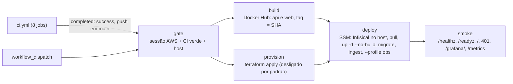

# 06 — Pipeline de deploy (F4, issue #17)

O `.github/workflows/deploy.yml` é o caminho automatizado de `.github/workflows/ci.yml` até o host
da F3: ele constrói as duas imagens, publica no **Docker Hub** com tag = SHA do commit, implanta por
SSM RunCommand e **prova a disponibilidade depois**. É o item que o `docs/00-edital-projeto-2.md`
§3.3 cobra: construir, publicar, implantar e verificar — sem clique humano entre as etapas e sem SSH.

A sequência espelha `docs/runbook-operacao.md` §2 (a versão manual), com uma diferença deliberada: os
segredos da aplicação **não vêm de `/opt/app/.env`**, e sim do **Infisical**, lidos no próprio host
antes de subir o compose. O CI de teste fica onde está — este workflow não repete a suíte.

## 1. A sequência de jobs



| job | `needs` | o que faz | quando roda |
| --- | --- | --- | --- |
| `gate` | — | `sts get-caller-identity`, resolve `sha`, exige `vars.DOCKERHUB_USERNAME` e os secrets do Infisical presentes, CI verde e host de pé | sempre (a checagem de host é pulada com `provision=true`) |
| `build` | `gate` | `docker build --target runtime` das duas imagens, `push` no Docker Hub com tag = SHA do commit e `docker manifest inspect` da tag | `skip_build != true` |
| `provision` | `gate` | `terraform init/validate/plan/apply` com as variáveis que o `tfvars` (ignorado pelo Git) daria | `provision == true` |
| `deploy` | `gate`, `build`, `provision` | resolve o host, espera o agente SSM, grava `compose.yaml`, o override **e `observability/` vindos do payload**, garante a CLI do Infisical, autentica a machine identity e roda `secrets-manager run` sobre `compose pull`, `up -d --no-build`, `npm run --silent prisma:deploy`, a ingestão pelo endpoint admin e, por último, `--profile obs up -d` | `gate` verde e nenhuma dependência falhou |
| `smoke` | `deploy` | `/healthz` JSON, `/readyz` JSON, `/` HTML, `POST /api/v1/admin/ingest` sem token → 401, `/grafana/` → 302 ou 401 e `/metrics` → 404 | `deploy` verde (`if` explícito, ver abaixo) |

**A stack de observabilidade entra no mesmo deploy, e a falha dela não é a falha da
aplicação.** O último passo do script remoto roda `--profile obs up -d --no-build` dentro do
mesmo `infisical secrets-manager run` — é de lá que vem `${GRAFANA_PASSWORD}`. Se ele falhar, a
API, o Postgres e o `web` continuam implantados, migrados e ingeridos: o job fica vermelho e o
sumário escreve "app no ar, observabilidade fora", porque repetir o dispatch basta e não há
rollback da aplicação a fazer. Os arquivos de `observability/` viajam no payload pelo mesmo motivo
dos compose: sem eles o Docker cria um diretório vazio no lugar do bind mount, `prometheus`,
`loki` e `promtail` entram em `restart loop` e o `up -d` responde `0` do mesmo jeito.

**O `smoke` declara o `if` explicitamente porque o implícito mente.** Um job com `needs` herda a
condição `success()`, e todo dispatch pula um job de propósito: `provision` no caminho normal,
`build` no rollback. O `deploy` já escapava disso com `!cancelled() && needs.*.result`; o `smoke`
não, e o run verde de 2026-11-21 entregou `deploy: success` com `smoke: skipped` sem rodar um
passo — a borda nunca era verificada. Agora a condição depende só do veredicto do `deploy`, e o
primeiro passo do job reprova com mensagem própria se `needs.deploy.outputs.public_ip` vier vazio.

`provision` é o único job que mexe em infraestrutura, e está **desligado por padrão**: o caminho
normal assume a stack da F3 de pé. Ele existe para o dia em que o ambiente tiver sido destruído e
alguém quiser o ciclo inteiro num único dispatch.

## 2. Gate de testes: `workflow_run`, não uma segunda suíte

O gatilho é `workflow_run` de `CI`, `types: [completed]`, `branches: [main]`. O job `gate` só existe
quando aquele run concluiu com `success` **e** veio de um `push` — o segundo filtro deixa de fora o
CI de um `pull_request` que aponte para `main`.

Consequências, todas deliberadas:

- **Repetir lint/typecheck/teste aqui seria caro e contraditório.** Dois veredictos para o mesmo
  commit podem divergir; o grafo do GitHub não diverge. O gate é estrutural: run vermelho de CI não
  gera run de deploy.
- **Run vermelho de CI não deixa um deploy vermelho para trás.** Nada nasce, nada fica `skipped` na
  tela — a evidência do gate é o run de CI vermelho (`docs/04-plano-de-execucao.md` F4, critério 2).
- **O dispatch manual é o único caminho fora do grafo**, e ele não escapa do gate: o passo *Prove the
  CI gate for a manual dispatch* consulta a API de Actions e exige ao menos um run `success` do
  `ci.yml` para o SHA que vai ser implantado (`permissions: actions: read`). CI vermelho para aquele
  SHA reprova o job `gate` — vermelho visível, com os jobs seguintes `skipped`.
- **`ci.yml` não muda.** O deploy é workflow separado, como o `docs/04` F4 pede.

## 3. O que configurar no GitHub (obrigatório)

Nada é criado por Terraform e não há role para assumir: a conta do Academy não deixa criar IAM.

**Secrets** (`Settings → Secrets and variables → Actions → Secrets`):

| secret | de onde vem | validade |
| --- | --- | --- |
| `AWS_ACCESS_KEY_ID` | *AWS Details* do Learner Lab | ~4 h |
| `AWS_SECRET_ACCESS_KEY` | *AWS Details* do Learner Lab | ~4 h |
| `AWS_SESSION_TOKEN` | *AWS Details* do Learner Lab | ~4 h |
| `DOCKERHUB_TOKEN` | Docker Hub → *Account settings → Personal access tokens* (escopo de leitura e escrita) | revogável |
| `INFISICAL_CLIENT_ID` | Infisical → *Access Control → Machine Identities → Universal Auth* | revogável |
| `INFISICAL_CLIENT_SECRET` | idem, exibido uma única vez na criação da identidade | revogável |

```bash
gh secret set AWS_ACCESS_KEY_ID        --body "$AWS_ACCESS_KEY_ID"
gh secret set AWS_SECRET_ACCESS_KEY    --body "$AWS_SECRET_ACCESS_KEY"
gh secret set AWS_SESSION_TOKEN        --body "$AWS_SESSION_TOKEN"
gh secret set DOCKERHUB_TOKEN          --body "$DOCKERHUB_TOKEN"
gh secret set INFISICAL_CLIENT_ID      --body "$INFISICAL_CLIENT_ID"
gh secret set INFISICAL_CLIENT_SECRET  --body "$INFISICAL_CLIENT_SECRET"
```

**Variables** (`... → Variables`):

| variable | para que serve |
| --- | --- |
| `DOCKERHUB_USERNAME` | usuário/namespace que publica e de onde o host puxa (hoje `emanuelr05`). Vazia, o `gate` reprova: sem ela o build não saberia onde publicar |
| `TF_STATE_BUCKET` (opcional) | só usada pelo `provision`; sem ela o job assume `bcc-cloud-tfstate-<account-id>`, a regra de `scripts/bootstrap-state.sh` |

```bash
gh variable set DOCKERHUB_USERNAME --body emanuelr05
```

**O que não é configurado aqui**: os cinco segredos da aplicação (`ADMIN_TOKEN`,
`POSTGRES_PASSWORD`, `DATABASE_URL`, `IP_HASH_SALT`, `LLM_API_KEY`) ficam **só no Infisical**
(projeto `2af53052-6e7a-4e59-a321-4525fa7fadae`, env `prod`). Eles nunca entram em `secrets` do
GitHub, nunca passam pelo runner e nunca aparecem em log. **Não é necessário**: chave privada do key
pair (não há SSH), `environment` com aprovadores, role OIDC, nem `AWS_REGION` (fixo em `us-east-1` —
é a única região que a sessão do lab aceita).

A machine identity do Infisical precisa de papel **read** no projeto — é tudo o que o deploy usa:
listar o ambiente `prod` e injetar as variáveis no processo do compose.

O disparo automático acontece a cada merge em `main` com CI verde. Como as credenciais AWS vencem em
~4 h, um merge fora da sessão do lab faz o `gate` reprovar com a mensagem de renovação — o deploy em
si não fica pela metade, porque o `gate` roda antes de qualquer trabalho caro. Pelo mesmo motivo ele
testa `DOCKERHUB_USERNAME` e os dois secrets do Infisical: faltando qualquer um, o run morreria no
`deploy` depois de ~40 min de `build`, e o custo do erro é todo do runner. As credenciais do Docker
Hub e do Infisical não vencem: elas são revogáveis, e revogar é o rollback de credencial.

## 4. Por que o desenho é este

**Sem OIDC.** `aws-actions/configure-aws-credentials` com `role-to-assume` precisa de um provider
OIDC e de uma role no IAM da conta. O sandbox não cria IAM (`docs/02-aws-academy-limites-e-riscos.md`
§8) e as credenciais entregues são de **sessão**, com `AWS_SESSION_TOKEN`. Por isso as três chaves
chegam por `secrets`, são mascaradas com `::add-mask::` antes do primeiro uso e o `gate` testa a
sessão com `sts get-caller-identity` antes de construir imagem. Elas servem a **duas** coisas: o SSM
e o `provision`. O job `build` não recebe credencial AWS nenhuma.

**Sem SSH.** O security group da F3 abre só a 80: com `allowed_ssh_cidrs = []` a regra da porta 22
nem existe. O canal é o **SSM RunCommand** (`AWS-RunShellScript`) — o mesmo que o ciclo da F3 usou.
Ganhos que justificam manter assim: nenhuma chave privada no runner, nenhuma porta aberta, e o
histórico de comandos fica no SSM. Pré-requisito: o `amazon-ssm-agent` da AMI Ubuntu e o
`LabInstanceProfile` com `ssm:*`; o job espera o `PingStatus` ficar `Online` por até 4 min e reprova
com mensagem explícita se não ficar.

**Docker Hub com repositório público.** As imagens `emanuelr05/skill-finder-api` e
`…-web` são públicas, então o pull no host é **anônimo**: nenhuma credencial de registry fica na VM
nem no `user_data`. O `DOCKERHUB_TOKEN` existe só no runner, para o `push`. O preço é a taxa de pull
anônima do Docker Hub, folgada para uma instância que só faz `up` por deploy.

**A prova da tag mudou de API.** Sem ECR não há `describe-images`; o `build` prova que a tag existe
com `docker manifest inspect` (12 tentativas de 5 s, para a propagação do registro) e **reprova o job**
se o manifesto não estiver lá. O `pull` do deploy continua sendo a prova final, com
`pull_policy: always`.

**`docker compose up -d --no-build` não é opcional.** A imagem vem do Docker Hub; sem a flag o
`compose.yaml` da raiz tentaria construir `api` e `web` neste host (`t3.small`, 2 GB). Com
`pull_policy: always` do `infra/deploy/compose.prod.yaml`, o digest é sempre o do registry — tag
igual com imagem local velha não passa.

**O compose e a configuração da observabilidade viajam no payload.** O `cd /opt/app` encontrava o
`compose.yaml` e o `infra/deploy/compose.prod.yaml` de um deploy anterior — e o override daquele
commit exigia `${ECR_REGISTRY:?}`, então o `compose pull` falhava em "required variable ECR_REGISTRY
is missing a value" antes de baixar qualquer imagem. Cópia manual não resolve para sempre: o job
`deploy` faz checkout do commit implantado e envia um `tar.gz` com os dois arquivos do compose **e
`observability/`** em `base64`; o host extrai em `/opt/app` antes de qualquer `compose pull`, e a
implantação deixa de depender do que sobrou no disco. O host não tem checkout, e bind mount sem
arquivo faz o Docker criar um diretório vazio no lugar: `prometheus`, `loki` e `promtail` subiriam em
`restart loop` e o `up -d` responderia `0` do mesmo jeito.

Esse payload é um **comando SSM separado** (*Ship the compose files and the obs config*), e não por
organização: o parâmetro `commands` do `SendCommand` para em ~24 KB, e os 12,4 KB do tar já vão em
`base64` dentro de um script que o helper *ainda* converte em `base64` — junto do script do deploy
(que carrega as credenciais da machine identity) o comando passaria de 31 KB e a AWS recusaria o
envio. Separados, o payload fica em ~18 KB e o deploy em ~8 KB, com folga. `observability/README.md`
não vai no tar: é documentação, não configuração. Depois de extrair, o script confere arquivo por
arquivo (inclusive `main.json` e o provisioning) e publica os `sha256` curtos no log; se algum sair
vazio, o deploy para antes do `pull`.

**Por que o Infisical roda no host, e não no runner.** O segredo tem de chegar ao processo que vai
usar: em produção é o `docker compose` do host que precisa de `DATABASE_URL`, `POSTGRES_PASSWORD`,
`ADMIN_TOKEN`, `IP_HASH_SALT` e `LLM_API_KEY` no ambiente, porque o `compose.yaml` passou a
**interpolar do ambiente** em vez de ler `env_file`. Trazer os valores para o runner só para
devolvê-los por SSM aumentaria a exposição (o payload do SSM fica no histórico de invocações) sem
nenhum ganho. O host é o ponto de menor privilégio: a machine identity tem papel `read`, o token vale
só enquanto o comando roda, a sessão que a CLI grava em `~/.infisical` do `root` nasce com
`umask 077` e o `trap` do script executa `infisical logout` em qualquer desfecho — sucesso, erro ou
sinal — apagando junto o script intermediário de `/tmp`. Sem esse par, a sessão ficaria no host entre
deploys.

**O que o host instala.** A CLI do Infisical, pelo repositório oficial
(`https://artifacts-cli.infisical.com/setup.deb.sh`), **somente se `infisical` não estiver no `PATH`**;
depois o script confere `infisical --version` e para se a instalação não ficou utilizável. O
`AWS-RunShellScript` roda como **root**, então não há `sudo` no caminho. O host não tem AWS CLI, e
continua sem precisar: quem fala com a AWS é o runner.

**`npm run --silent prisma:deploy`, nunca `pnpm`.** A imagem `runtime` não tem o pnpm do repositório
nem `scripts/`/`ts-node`; a migração e a ingestão usam o que existe na imagem e a rota admin.

**Tag = SHA do commit** nos dois repositórios. O SHA vem do `gate` (no caminho automático é o
`github.sha`; num dispatch com `image_tag`, é o commit que o `deploy` vai puxar). O caminho manual do
runbook usa o SHA curto de `git rev-parse --short HEAD`; as duas tags convivem. `latest` não é
publicado — e o Docker Hub **não expira tag**, então o rollback por SHA continua disponível sem a
janela de 5 imagens que o ECR impunha.

### 4.1 O client secret no payload do SSM — risco conhecido

O comando que o deploy envia por SSM começa com o `INFISICAL_CLIENT_ID` e o
`INFISICAL_CLIENT_SECRET` (escapados por `printf %q`). Consequência: **os dois valores ficam no
histórico de invocações do SSM** (`ssm get-command-invocation`), legível por quem tem `ssm:*` na
conta do lab, e permanecem lá mesmo depois de revogados.

Isso é uma **decisão consciente e temporária**, tomada porque o lab não oferece canal melhor:

- a porta 22 está fechada, então não existe sessão em que o operador alimente o host "por fora";
- a conta não cria IAM, então não há role para o host assumir nem `ssm:GetParameter` com KMS
  garantidos;
- a identidade universal é a única autenticação que o Infisical expõe sem OIDC.

O que limita o dano hoje: o client secret só **lê** o env `prod` do projeto; o runner o mascara com
`::add-mask::` antes do primeiro uso; e revogar a identidade (`Access Control → Machine Identities →
Revoke`) invalidada o valor, inclusive o que está no histórico. O residual é que, entre um deploy e
a revogação, quem lê o histórico tem os cinco segredos.

**O caminho correto — operador escreve `/opt/app/.infisical` uma vez por instância.** O deploy passa
a só **ler** o arquivo:

```bash
# uma vez por instância, com o operador na sessão que ele já tem:
sudo install -m 600 -o root -g root /dev/stdin /opt/app/.infisical <<'EOF'
INFISICAL_CLIENT_ID=<client-id>
INFISICAL_CLIENT_SECRET=<client-secret>
EOF
```

No script remoto, no lugar das duas linhas `printf`:

```bash
if [ ! -r /opt/app/.infisical ]; then
  echo "ERRO: /opt/app/.infisical ausente; o operador cria uma vez por instancia (docs/app/06 §4.1)" >&2
  exit 1
fi
set -a; . /opt/app/.infisical; set +a
```

O payload do SSM deixa de ter segredo nenhum, o arquivo é `root:root 0600` e sobrevive a deploy; a
rotação é reescrever o arquivo. O que ele custa: um passo manual **por instância nova** (o `user_data`
não pode escrevê-lo sem que o segredo esteja no Terraform) e um estado que o pipeline não consegue
reconstruir sozinho — daí ele falhar fechado com a mensagem acima. Um passo além, fora do alcance do
Academy: guardar as duas chaves em SSM Parameter Store `SecureString` e ler com a role da instância,
o que elimina o arquivo e o passo manual.

### 4.2 O primeiro deploy depois da troca

O `compose.yaml` da raiz não lê mais `/opt/app/.env`: as variáveis vêm do ambiente, e o deploy roda o
compose com `--env-file /dev/null` para que um `.env` deixado por execuções anteriores **não** entre
na interpolação (se o compose do host for antigo demais para a flag, o deploy segue e avisa no log).
Se o arquivo existir, o deploy **avisa e não apaga** — remover é decisão do dono, depois de validar.
O mesmo vale para os arquivos do compose: o host pode ter a versão de um commit anterior, e o payload
os sobrescreve com a do commit que está sendo implantado — inclusive num rollback, que faz checkout da
tag escolhida.

Dois pontos de atenção na primeira execução:

1. **O volume do Postgres já foi inicializado com a senha antiga.** A senha do banco é fixada na
   criação do volume; se o `POSTGRES_PASSWORD`/`DATABASE_URL` do Infisical não for a mesma que o
   `.env` usava, a API sobe e falha na conexão. Alinhe o segredo do Infisical com a senha vigente
   **ou** recrie o volume (perde os dados do catálogo, que é reprodutível pela ingestão).
2. **A fonte real do catálogo não é segredo e não está no Infisical**: o deploy exporta
   `SKILL_SOURCE_KIND=html`, `WEB_PORT=80`, `POSTGRES_USER=skills` e `POSTGRES_DB=skills` antes de
   chamar o compose. Sem isso o schema cairia no default `fixture` e a borda subiria na 8081.

## 5. Como rodar

**Local, antes de qualquer dispatch** — as mesmas checagens do `gate`:

```bash
bash scripts/dev/deploy-preflight.sh            # completo: AWS, host, SSM e secrets do repo
bash scripts/dev/deploy-preflight.sh --offline  # só arquivos, invariantes do YAML e ferramentas
```

O código de saída é 1 quando falta algo, e cada pendência sai com o comando que resolve. O
`deploy-preflight.sh` acompanha este pipeline: confere os seis secrets, a variable
`DOCKERHUB_USERNAME`, o host, o agente SSM e as invariantes do `deploy.yml` — sem o registry antigo,
`--env-file /dev/null`, token do Docker Hub mascarado, `docker manifest inspect`, compose no payload,
`umask 077` e `infisical logout`. `--offline` roda só arquivos, invariantes e ferramentas. A dívida
que fica é estrutural: o script espelha o `gate` escrevendo as regras à mão (§10).

**Automático**: merge em `main` → CI verde → deploy. Nada a digitar.

**Manual** (sessão do lab aberta):

```bash
gh workflow run deploy.yml --ref main
gh run watch "$(gh run list --workflow deploy.yml --limit 1 --json databaseId --jq '.[0].databaseId')"
```

**Com infraestrutura derrubada** (raro, custa crédito e tempo):

```bash
gh workflow run deploy.yml --ref main -f provision=true
```

**Só reimplantar o que já está no Docker Hub** (sem build):

```bash
gh workflow run deploy.yml --ref main -f skip_build=true
```

**Rollback** — cada tag é um SHA e o Docker Hub não expira tags:

```bash
gh workflow run deploy.yml --ref main -f image_tag=<sha-anterior> -f skip_build=true
```

O caminho é o mesmo do deploy (Infisical, pull, `up -d --no-build`, migração, obs, smoke), então o
rollback também é verificado. Migrations aplicadas **não** voltam: elas são para frente por desenho, e
é por isso que a migração entra antes do smoke. Se a tag anterior não existir mais no Docker Hub, o
rollback é republicar o commit antigo (build a partir dele).

**A stack de observabilidade sobe no mesmo dispatch, sem comando extra.** O último passo do SSM roda
`docker compose --env-file /dev/null -f compose.yaml -f infra/deploy/compose.prod.yaml --profile prod
--profile obs up -d --no-build` com `observability/` já escrito em `/opt/app` pelo payload. O que
muda na operação:

- **Grafana na borda**: `http://<host_public_ip>/grafana/` responde `302` para o login (ou `401` em
  rota de API sem sessão). Nada de painel aberto: `GF_AUTH_ANONYMOUS_ENABLED` é `false` e a senha do
  `admin` vem de `${GRAFANA_PASSWORD}` no Infisical (env `prod`).
- **A borda não depende da stack obs para subir.** O `proxy_pass` do `/grafana/` usa uma variável com
  `resolver 127.0.0.11` (DNS do Docker), e não o nome literal: upstream estático é resolvido **no
  boot**, e sem o container `grafana` na rede o nginx morreria com `host not found in upstream`,
  levando a API junto — inclusive no `make up` de dev, onde o profile `obs` não sobe. Com a variável,
  a resolução é por requisição e o pior caso é `502` em `/grafana/`, com o resto do site no ar. Sem
  barra final no destino: com ela o nginx trocaria `/grafana/x` por `/x` e o Grafana, que serve em
  sub-path, responderia `404` em toda rota.
- **Prometheus, Loki e node-exporter ficam em loopback** (`127.0.0.1:9090`, `:3100`, `:9100`): sem
  autenticação, quem os expõe é o Grafana, e nenhum deles é roteado pelo nginx. `/metrics` da
  aplicação continua `404` na borda.
- **Conferir depois do deploy**: `docker compose --profile obs ps` no host (o `up -d` responde `0`
  mesmo com container em `restart loop`, então o `ps` é a prova de vida barata); os comandos de cada
  painel estão em `observability/README.md`.
- **Se a stack obs não subir**, o app continua no ar e o job fica vermelho com "app no ar,
  observabilidade fora" no sumário — basta corrigir e repetir o dispatch.

## 6. O que o smoke prova

O job `smoke` roda na borda pública (`http://<host_public_ip>`), não no host, e reprova o workflow
em qualquer desvio:

| checagem | esperado | o que um desvio significa |
| --- | --- | --- |
| `GET /healthz` | `200`, JSON com `status: "ok"` | processo da API fora ou nginx sem proxy — segredo ausente/inválido no Infisical é a causa mais comum |
| `GET /readyz` | `200`, JSON com `status: "ok"` | API viva e Postgres fora: o envelope `NOT_READY` aparece no corpo |
| `GET /` | `200`, `text/html` com `<!doctype html>` | a SPA não subiu ou o `web` está servindo outro conteúdo |
| `POST /api/v1/admin/ingest` sem token | `401` | o guard do `X-Admin-Token` não está na frente da rota admin |
| `GET /grafana/` | `302` (login) ou `401` | `200` é o Grafana aberto na internet; `404` é o proxy apontando para um Grafana sem `GF_SERVER_SERVE_FROM_SUB_PATH`; `502` é a stack obs fora |
| `GET /metrics` | `404` | a borda parou de fechar a rota e os contadores de latência por rota estão públicos |

Antes das seis, um passo espera a borda responder por até 2 min (o nginx leva alguns segundos para
ficar pronto depois do `up`). O `$GITHUB_STEP_SUMMARY` do job `deploy` publica o SHA, o IP público,
as duas imagens, o registry e o veredicto da observabilidade; o do `smoke` publica a resposta
observada de cada checagem. Nenhum segredo entra no sumário: o `ADMIN_TOKEN` é lido do ambiente do
Infisical dentro do host e nunca sai dele.

## 7. Permissões, segredos e custo

- `permissions: contents: read` e `actions: read`. Nada escreve na API do GitHub.
- `concurrency: deploy-<ref>` com `cancel-in-progress: false`: dois deploys não se cruzam, e abortar
  entre `up -d` e `prisma:deploy` deixaria a stack meio atualizada.
- `timeout-minutes` em todos os jobs (10/40/25/30/10) e `--timeout-seconds 900` em cada comando SSM.
- Segredos mascarados com `::add-mask::` antes do primeiro uso, em cada job que os recebe
  (`AWS_*`, `DOCKERHUB_TOKEN`, `INFISICAL_CLIENT_ID`, `INFISICAL_CLIENT_SECRET`).
- Menor privilégio por job: `build` só tem o token do Docker Hub; `gate` e `deploy` só as credenciais
  AWS de sessão; `deploy` é o único que **usa** as credenciais do Infisical — o `gate` as recebe
  apenas para reprovar cedo quando faltam (`[ -z ]`, nunca as usa); `smoke` não tem segredo nenhum.
- Custo: ~6–12 min de runner por deploy, duas imagens pequenas, nenhum recurso AWS novo (o
  `provision` só roda sob demanda) e nenhum custo de Docker Hub ou Infisical no plano gratuito.
- Memória: `infra/deploy/compose.prod.yaml` fixa `mem_limit` em `api` 600M, `postgres` 512M e `web`
  96M; o `compose.yaml` já limita os cinco da stack obs (1,22 GiB somados). **A soma passa dos 2 GB
  do `t3.small`** — os tetos são por container, não reservas, e a stack vive disso porque nenhum
  serviço chega ao próprio limite em regime normal. Se o host começar a matar processo por OOM, a
  correção é reduzir teto (Grafana e Loki são os maiores) ou trocar a instância, não remover o limite.

## 8. Ações pinadas

O padrão do repositório hoje é **tag de major** (`actions/checkout@v7`, `pnpm/action-setup@v6` no
`ci.yml`), com o endurecimento para SHA anotado como uma linha por `uses:`. Este workflow segue o
mesmo padrão: `actions/checkout@v7`, `docker/login-action@v3`, `hashicorp/setup-terraform@v3`. Para
congelar em SHA, um `uses:` por linha, resolvido pela API:

```bash
gh api repos/actions/checkout/commits/v7 --jq .sha
gh api repos/docker/login-action/commits/v3 --jq .sha
gh api repos/hashicorp/setup-terraform/commits/v3 --jq .sha
```

Nenhuma action recebe tag móvel `latest`, e a imagem do projeto nunca é publicada como `latest`.

## 9. O que ainda não foi verificado

O workflow foi escrito e validado estaticamente — YAML, sintaxe bash de cada `run:`, o script remoto
renderizado e as duas configurações do compose (`dev` e `prod`). **Não houve execução real**: este
ambiente não tem credenciais do Academy, machine identity do Infisical nem a stack da F3 de pé. Fica
pendente de uma sessão do lab, e cada item vira evidência em `docs/evidencias/`:

1. Run verde de ponta a ponta (`gate → build → deploy → smoke`) com o sumário preenchido.
2. Run vermelho por teste quebrado de propósito, mostrando que o CI reprovado não gera deploy — e o
   `gate` vermelho no dispatch manual do mesmo commit.
3. `docker manifest inspect emanuelr05/skill-finder-api:<sha>` e `…-web:<sha>` com o mesmo SHA que o
   host está rodando (`docker compose ps`).
4. Smoke reprovando de verdade: parar o Postgres no host e ver o `smoke` (não o `deploy`) vermelho.
5. Instalação da CLI do Infisical pelo `setup.deb.sh` no host real (`infisical --version` no log do
   SSM) e o `secrets-manager run` injetando as cinco variáveis no `compose`.
6. Permissões `ssm:*` do `LabRole` na sessão real (o ciclo da F3 já usou o canal, mas o job falha
   alto se o `PingStatus` não ficar `Online`).
7. `gh secret list` confirmando os seis secrets e a busca pelo prefixo de cada valor no log do run sem
   resultado (credencial mascarada).
8. O `--env-file /dev/null` na versão de `docker-compose-v2` que o `user_data` instala (a flag existe
   no 2.40 local; se o host tiver versão anterior, o deploy avisa em vez de falhar).
9. `deploy-preflight.sh` na versão atual (seis secrets, `DOCKERHUB_USERNAME` e as invariantes) contra
   um repositório real, e o runbook §1.5 reescrito para o caminho sem `.env`, ou marcado como legado.
10. A stack obs no host real: `docker compose --profile obs ps` com os cinco containers de pé,
    `http://<host>/grafana/` respondendo `302` e um painel desenhando (o `prometheus.yml` do
    repositório precisa alcançar `api:8000` pela rede do compose). O smoke cobre o Grafana pela
    borda; **Prometheus, Loki e Promtail não têm asserção** — só o `ps` do log do SSM.

## 10. Dívida conhecida

O que este pipeline ainda faz abaixo do padrão que ele mesmo documenta. Nenhum item bloqueia o deploy
de hoje; todos têm o caminho de correção ao lado.

1. **A CLI do Infisical não é pinada por hash.** A instalação usa `curl --proto '=https'
   --tlsv1.2` sobre `https://artifacts-cli.infisical.com/setup.deb.sh`, mas o `.deb` que chega não é
   conferido: um pacote novo do upstream entra no próximo host sem deploy nenhum. Correção:
   baixar `infisical_<versão>_amd64.deb` de versão fixa, conferir o `sha256` contra um valor no
   repositório e instalar com `apt-get install ./arquivo.deb`. O §9.5 prova que a instalação roda no
   host real; hash nenhum é conferido hoje.
2. **As credenciais da machine identity viajam no payload do SSM** em vez de morarem em
   `/opt/app/.infisical` (§4.1). Enquanto a conta do Academy não permitir IAM nem
   `ssm:GetParameter` com KMS, o caminho correto está documentado e não implementado — o residual é o
   histórico de invocações do SSM.
3. **A imagem é referenciada por tag, não por digest.** `pull_policy: always` fixa o digest **no
   momento do pull**; se a tag do SHA for reescrita no Docker Hub, o mesmo commit implanta outra
   imagem sem mudar uma linha do repositório. Correção: resolver o digest do manifesto no `build` e
   escrever `image: <repo>@sha256:<digest>` (ou exportar `IMAGE_DIGEST`) no compose do host.
4. **O `deploy-preflight.sh` reimplementa as invariantes do `gate`.** As regras de §2 são `grep` à
   mão num script separado: o workflow pode ganhar uma invariante e o preflight continuar verde.
   Correção: `actionlint` no CI para o YAML e um único `scripts/dev/deploy-preflight.sh` que lê as
   regras de um arquivo de dados, em vez de duas listas para manter.
5. **`GF_SERVER_SERVE_FROM_SUB_PATH` e `GF_SERVER_ROOT_URL` moram no override de prod, não no
   `compose.yaml`.** A #62 precisava de `/grafana/` na borda e o `compose.yaml` estava fora do escopo
   dela; o efeito é que `make PROFILE=obs up` em dev continua servindo o Grafana na raiz e o prefixo
   `/grafana/` do nginx responde `404` lá. Correção: mover as duas chaves para o serviço `grafana` do
   `compose.yaml` e apagar o bloco do override. O `%` fica: `root_url` com `%(protocol)s://%(domain)s/grafana/`
   só resolve host absoluto em e-mail e OAuth, nunca na navegação.
6. **A borda assume o DNS embutido do Docker.** O `/grafana/` resolve o upstream em tempo de
   requisição contra `127.0.0.11`, que é o resolver das redes *user-defined* do compose. Se o `web`
   sair desse modelo (host network, Kubernetes, outro orquestrador), o `resolver` aponta para um
   endereço que não responde e `/grafana/` fica em `502` — o resto do site não é afetado. Correção
   nesse dia: trocar o `resolver` pelo do ambiente (CoreDNS/`kube-dns`) ou voltar ao nome literal no
   `proxy_pass`, aceitando que o nginx passe a exigir a stack obs para subir.
