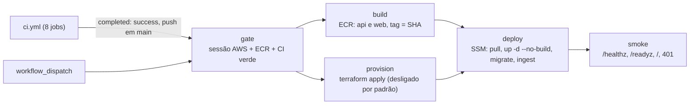

# 06 — Pipeline de deploy (F4, issue #17)

O `.github/workflows/deploy.yml` é o caminho automatizado de `.github/workflows/ci.yml` até o host
da F3: ele constrói as duas imagens, publica no ECR com tag = SHA do commit, implanta por SSM
RunCommand e **prova a disponibilidade depois**. É o item que o `docs/00-edital-projeto-2.md` §3.3
cobra: construir, publicar, implantar e verificar — sem clique humano entre as etapas e sem SSH.

A sequência é a mesma de `docs/runbook-operacao.md` §2 (a versão manual): nada aqui inventa um
comando novo, o que muda é quem aperta o botão. O CI de teste fica onde está — este workflow não
repete a suíte.

## 1. A sequência de jobs



| job | `needs` | o que faz | quando roda |
| --- | --- | --- | --- |
| `gate` | — | `sts get-caller-identity`, resolve `sha` e `ecr_registry`, exige CI verde e host de pé | sempre (a checagem de host é pulada com `provision=true`) |
| `build` | `gate` | `docker build --target runtime` das duas imagens e `push` com tag = `github.sha`; confere a tag no ECR | `skip_build != true` |
| `provision` | `gate` | `terraform init/validate/plan/apply` com as variáveis que o `tfvars` (ignorado pelo Git) daria | `provision == true` |
| `deploy` | `gate`, `build`, `provision` | resolve o host, espera o agente SSM, atualiza `IMAGE_TAG`, `compose pull`, `up -d --no-build`, `npm run --silent prisma:deploy` e a ingestão pelo endpoint admin | `gate` verde e nenhuma dependência falhou |
| `smoke` | `deploy` | `/healthz` JSON, `/readyz` JSON, `/` HTML e `POST /api/v1/admin/ingest` sem token → 401 | `deploy` verde |

`provision` é o único job que mexe em infraestrutura, e está **desligado por padrão**: o caminho
normal assume a stack da F3 de pé. Ele existe para o dia em que o ambiente tiver sido destruído e
alguém quiser o ciclo inteiro num único dispatch.

## 2. Gate de testes: `workflow_run`, não uma segunda suíte

O gatilho é `workflow_run` de `CI`, `types: [completed]`, `branches: [main]`. O job `gate` só existe
quando aquele run concluiu com `success` **e** veio de um `push` — o segundo filtro deixa de fora o
CI de um `pull_request` que aponte para `main`.

Consequências, todas deliberadas:

- **Repetir lint/typecheck/teste aqui seria caro e contraditório.** Dois veredictos para o mesmo
  commit podem divergir; o grafo do GitHub não diverge. O gate é estrutural: run vermelho de CI não
  gera run de deploy.
- **Run vermelho de CI não deixa um deploy vermelho para trás.** Nada nasce, nada fica `skipped` na
  tela — a evidência do gate é o run de CI vermelho (`docs/04-plano-de-execucao.md` F4, critério 2).
- **O dispatch manual é o único caminho fora do grafo**, e ele não escapa do gate: o passo *Prove the
  CI gate for a manual dispatch* consulta a API de Actions e exige ao menos um run `success` do
  `ci.yml` para o SHA que vai ser implantado (`permissions: actions: read`). CI vermelho para aquele
  SHA reprova o job `gate` — vermelho visível, com os jobs seguintes `skipped`.
- **`ci.yml` não muda.** O deploy é workflow separado, como o `docs/04` F4 pede.

## 3. O que configurar no GitHub (obrigatório)

Nada é criado por Terraform e não há role para assumir: a conta do Academy não deixa criar IAM.

**Secrets** (`Settings → Secrets and variables → Actions → Secrets`):

| secret | de onde vem | validade |
| --- | --- | --- |
| `AWS_ACCESS_KEY_ID` | *AWS Details* do Learner Lab | ~4 h |
| `AWS_SECRET_ACCESS_KEY` | *AWS Details* do Learner Lab | ~4 h |
| `AWS_SESSION_TOKEN` | *AWS Details* do Learner Lab | ~4 h |

```bash
gh secret set AWS_ACCESS_KEY_ID   --body "$AWS_ACCESS_KEY_ID"
gh secret set AWS_SECRET_ACCESS_KEY --body "$AWS_SECRET_ACCESS_KEY"
gh secret set AWS_SESSION_TOKEN   --body "$AWS_SESSION_TOKEN"
```

**Variable** (opcional): `TF_STATE_BUCKET`, só usada pelo `provision`. Sem ela o job assume
`bcc-cloud-tfstate-<account-id>`, que é a regra de `scripts/bootstrap-state.sh`.

**Não é necessário**: chave privada do key pair (não há SSH), `environment` com aprovadores, role
OIDC, nem `AWS_REGION` (fixo em `us-east-1` — é a única região que a sessão do lab aceita).

O disparo automático acontece a cada merge em `main` com CI verde. Como as credenciais vencem em
~4 h, um merge fora da sessão do lab faz o `gate` reprovar com a mensagem de renovação — o deploy em
si não fica pela metade, porque o `gate` roda antes de qualquer trabalho caro.

## 4. Por que o desenho é este (limites do Academy)

**Sem OIDC.** `aws-actions/configure-aws-credentials` com `role-to-assume` precisa de um provider
OIDC e de uma role no IAM da conta. O sandbox não cria IAM (`docs/02-aws-academy-limites-e-riscos.md`
§8) e as credenciais entregues são de **sessão**, com `AWS_SESSION_TOKEN`. Por isso as três chaves
chegam por `secrets`, são mascaradas com `::add-mask::` antes do primeiro uso e o `gate` testa a
sessão com `sts get-caller-identity` antes de construir imagem.

**Sem SSH.** O security group da F3 abre só a 80: com `allowed_ssh_cidrs = []` a regra da porta 22
nem existe. O canal é o **SSM RunCommand** (`AWS-RunShellScript`) — o mesmo que o ciclo da F3 usou.
Ganhos que justificam manter assim: nenhuma chave privada no runner, nenhuma porta aberta, e o
histórico de comandos fica no SSM. Pré-requisito: o `amazon-ssm-agent` da AMI Ubuntu e o
`LabInstanceProfile` com `ssm:*`; o job espera o `PingStatus` ficar `Online` por até 4 min e reprova
com mensagem explícita se não ficar.

**Nada de AWS CLI nem de repositório no host.** O host executa o que vem do ECR; o pipeline não
instala nada nele. O único arquivo que o deploy toca em `/opt/app` é o `IMAGE_TAG` do `.env` — o
resto do `.env` (senha do banco, `ADMIN_TOKEN`, chave da LLM) foi criado na F3 e continua lá. Se o
`.env` não existir, o deploy para e manda refazer a §1.5 do runbook: o pipeline não inventa segredo.

**`docker compose up -d --no-build` não é opcional.** A imagem vem do ECR; sem a flag o
`compose.yaml` da raiz tentaria construir `api` e `web` neste host (`t3.small`, 2 GB). Com
`pull_policy: always` do `infra/deploy/compose.prod.yaml`, o digest é sempre o do registry — tag
igual com imagem local velha não passa.

**`npm run --silent prisma:deploy`, nunca `pnpm`.** A imagem `runtime` não tem o pnpm do repositório
nem `scripts/`/`ts-node`; a migração e a ingestão usam o que existe na imagem e a rota admin.

**Tag = `github.sha`** (40 caracteres) nos dois repositórios. O caminho manual do runbook usa o SHA
curto de `git rev-parse --short HEAD`; as duas tags convivem no ECR. O repositório é `MUTABLE`
(`infra/ecr.tf`), então a tag não é garantia de conteúdo por si — o que identifica o artefato aqui é
o SHA do commit, e o `build` confere a tag no `describe-images` antes de o `deploy` usar. `latest`
não é publicado.

## 5. Como rodar

**Local, antes de qualquer dispatch** — as mesmas checagens do `gate`:

```bash
bash scripts/dev/deploy-preflight.sh            # completo: AWS, host, SSM e secrets do repo
bash scripts/dev/deploy-preflight.sh --offline  # só arquivos, invariantes do YAML e ferramentas
```

O código de saída é 1 quando falta algo, e cada pendência sai com o comando que resolve.

**Automático**: merge em `main` → CI verde → deploy. Nada a digitar.

**Manual** (sessão do lab aberta):

```bash
gh workflow run deploy.yml --ref main
gh run watch "$(gh run list --workflow deploy.yml --limit 1 --json databaseId --jq '.[0].databaseId')"
```

**Com infraestrutura derrubada** (raro, custa crédito e tempo):

```bash
gh workflow run deploy.yml --ref main -f provision=true
```

**Só reimplantar o que já está no ECR** (sem build):

```bash
gh workflow run deploy.yml --ref main -f skip_build=true
```

**Rollback** — o ECR guarda as 5 imagens mais recentes de cada repositório (`infra/ecr.tf`):

```bash
gh workflow run deploy.yml --ref main -f image_tag=<sha-anterior> -f skip_build=true
```

O caminho é o mesmo do deploy (pull, `up -d --no-build`, migração, smoke), então o rollback também
é verificado. Migrations aplicadas **não** voltam: elas são para frente por desenho, e é por isso que
a migração entra antes do smoke. Se o SHA anterior já saiu da janela de 5 imagens, o rollback é
republicar o commit antigo (build a partir dele).

## 6. O que o smoke prova

O job `smoke` roda na borda pública (`http://<host_public_ip>`), não no host, e reprova o workflow
em qualquer desvio:

| checagem | esperado | o que um desvio significa |
| --- | --- | --- |
| `GET /healthz` | `200`, JSON com `status: "ok"` | processo da API fora ou nginx sem proxy — `.env` inválido é a causa mais comum |
| `GET /readyz` | `200`, JSON com `status: "ok"` | API viva e Postgres fora: o envelope `NOT_READY` aparece no corpo |
| `GET /` | `200`, `text/html` com `<!doctype html>` | a SPA não subiu ou o `web` está servindo outro conteúdo |
| `POST /api/v1/admin/ingest` sem token | `401` | o guard do `X-Admin-Token` não está na frente da rota admin |

Antes das quatro, um passo espera a borda responder por até 2 min (o nginx leva alguns segundos para
ficar pronto depois do `up`). O `$GITHUB_STEP_SUMMARY` do job `deploy` publica o SHA, o IP público,
as duas imagens e o registry; o do `smoke` publica a resposta observada de cada checagem. Nenhum
segredo entra no sumário: o `ADMIN_TOKEN` é lido dentro do host e nunca sai dele.

## 7. Permissões, segredos e custo

- `permissions: contents: read` e `actions: read`. Nada escreve na API do GitHub.
- `concurrency: deploy-<ref>` com `cancel-in-progress: false`: dois deploys não se cruzam, e abortar
  entre `up -d` e `prisma:deploy` deixaria a stack meio atualizada.
- `timeout-minutes` em todos os jobs (10/40/25/30/10) e `--timeout-seconds 900` em cada comando SSM.
- Credenciais mascaradas com `::add-mask::` antes do primeiro uso, em cada job que fala com a AWS.
- Custo: ~6–10 min de runner por deploy, build de duas imagens pequenas e nenhum recurso AWS novo
  (o `provision` só roda sob demanda). O ECR expira sozinho depois de 5 imagens por repositório.

## 8. Ações pinadas

O padrão do repositório hoje é **tag de major** (`actions/checkout@v7`, `pnpm/action-setup@v6` no
`ci.yml`), com o endurecimento para SHA anotado como uma linha por `uses:`. Este workflow segue o
mesmo padrão: `actions/checkout@v7`, `aws-actions/amazon-ecr-login@v2`,
`hashicorp/setup-terraform@v3`. Para congelar em SHA, um `uses:` por linha, resolvido pela API:

```bash
gh api repos/actions/checkout/commits/v7 --jq .sha
gh api repos/aws-actions/amazon-ecr-login/commits/v2 --jq .sha
gh api repos/hashicorp/setup-terraform/commits/v3 --jq .sha
```

Nenhuma action recebe tag móvel `latest`, e a imagem do projeto nunca é publicada como `latest`.

## 9. O que ainda não foi verificado

O workflow foi escrito e validado estaticamente — YAML, invariantes e sintaxe bash. **Não houve
execução real**: este ambiente não tem credenciais do Academy nem a stack da F3 de pé. Fica pendente
de uma sessão do lab, e cada item vira evidência em `docs/evidencias/`:

1. Run verde de ponta a ponta (`gate → build → deploy → smoke`) com o sumário preenchido.
2. Run vermelho por teste quebrado de propósito, mostrando que o CI reprovado não gera deploy — e o
   `gate` vermelho no dispatch manual do mesmo commit.
3. `aws ecr describe-images` com a tag do SHA implantado.
4. Smoke reprovando de verdade: parar o Postgres no host e ver o `smoke` (não o `deploy`) vermelho.
5. Permissões `ssm:*` do `LabRole` na sessão real (o ciclo da F3 já usou o canal, mas o job falha
   alto se o `PingStatus` não ficar `Online`).
6. `gh secret list` confirmando os três secrets, e a busca pelo prefixo da chave no log do run sem
   resultado (credencial mascarada).
